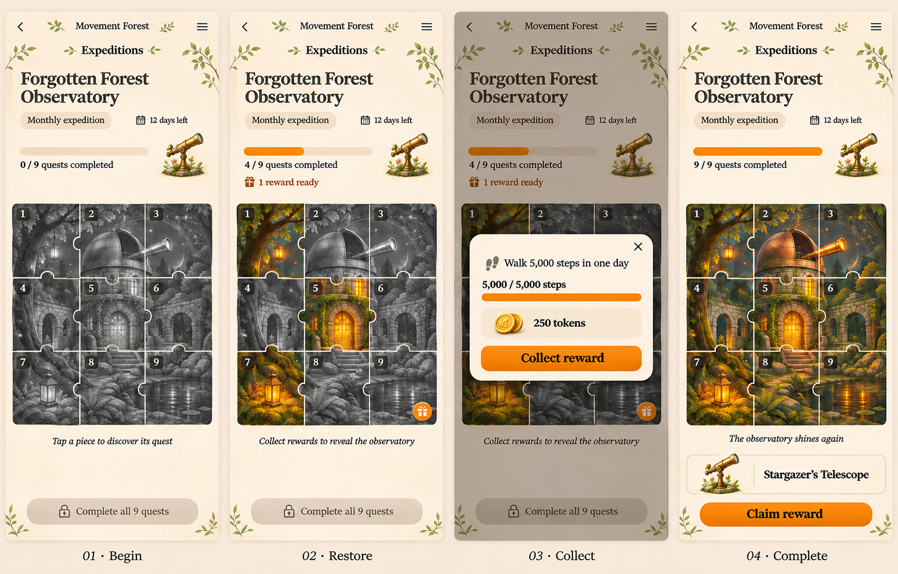

# Monthly expeditions — implementation specification

Created: 15 November 2026
Updated: 19 November 2026 — recurring monthly renewal, milestone-style presentation and detailed implementation handoff
Status: product specification with source implementation now added. See [backend/EXPEDITIONS.md](backend/EXPEDITIONS.md) for the implementation, publication and long-absence recovery contract, and [native acceptance](frontend/EXPEDITIONS_ACCEPTANCE.md) for remaining Mac/iPhone checks. No live expedition is activated.

This document defines the first monthly expedition's product behavior. The user's selected quests, visual design, normal-sync-plus-catch-up strategy and section 6 rewards are fixed below. The detailed, source-inspected engineering handoff is [EXPEDITIONS_IMPLEMENTATION_PLAN.md](EXPEDITIONS_IMPLEMENTATION_PLAN.md). Technical defaults are identified separately so a builder can implement without reopening settled design decisions. Estimates below are historical planning ranges, not measured implementation results. The clean observatory painting/masks, launch month and validated reward/item publication definitions remain release inputs; engineering can proceed with clearly marked development fixtures.

### Latest requirements and asset corrections — 19 November 2026

- **Renew on the first of every calendar month**, repeating the same Observatory expedition until a new expedition is explicitly assigned to a future month. Use server-wide **00:00 UTC** boundaries for every account, as clarified by the user after the initial plan. Expedition step-day objectives use UTC dates; ordinary growth and daily item skills keep their account-local game dates. Renewal creates fresh quest progress, completion/collection state and puzzle restoration; it preserves owned rewards, earlier runs and already-earned unclaimed rewards. The same full reward schedule can be earned again once in each new run. Existing qualifying garden arrangements can immediately complete the new run's snapshot quests.
- **All expedition progress ratios belong inside their bars**, including the overall nine-quest bar and popup bars. This supersedes the concept board's numeric labels outside bars and the older popup wording below.
- **The centred quest popup follows the current milestones page's design language.** Visible rewards show quantity first, followed by artwork (`250 <token icon>`, `1 <pack image>`, `1 <item thumbnail>`). Retain full accessible reward names. Preserve the exact requirement, centred overlay, close control and collection/reveal behavior; do not reproduce the mockup's old typography/reward ordering literally.
- **The two new item packages now exist** under `assets/items/astronomers-satchel/v1` and `assets/items/comet-basin/v1`. Reuse them alongside the existing Orrery package. Their production source is [art/observatory-items-production/SOURCE.md](art/observatory-items-production/SOURCE.md). The Basin's comet is stationary; its authored animation is expanding water ripples. Older passages describing unfinished item art or optional comet bobbing are superseded.
- Use the concrete asset IDs `astronomers-satchel` and `comet-basin` for runtime registration, retaining the selected full reward display names. The longer IDs in section 6 were proposals. Include full ownership/placement/reward support, Guiding Glow and the Orrery's Alignment of Worlds trigger infrastructure; the Satchel has no skill. Keep all three reward-only and outside existing shop pools.

These latest requirements override conflicting older prose or illustrative renders. Source implementation now follows them, including the later server-UTC clarification. The implementation plan records the engineering scope; the backend guide records the implemented contract and release procedure.

## 1. User's concept

Create a monthly event in its own **Expedition** tab. Each calendar month starts a fresh run of the same expedition until a replacement is assigned, with quests that restore portions of an illustrated hollow or reveal pieces of a map/puzzle.

- Quests are primarily activity-related, with some garden-related objectives.
- Each distinct map region is tappable and shows the quest required to restore it.
- Completing a quest advances overall completion and earns a small reward, such as tokens, gems or an unopened pack. Collecting that reward reveals the corresponding puzzle piece in colour.
- Completing the entire expedition earns the existing **Legendary Worldseed Orrery**, with its previously selected Alignment of Worlds skill. Completing any four quests separately earns the new Rare Comet-Catcher's Basin.
- The top of the screen shows completion progress and the route toward the final cosmetic.
- Restoration should provide beautiful visual feedback.

The first expedition uses **nine quests** and the **Forgotten Forest Observatory** theme. Section 4 is the authoritative quest list. Earlier suggestions involving flights, five adult trees/herbs, login streaks, rare species or all variants are not part of these nine quests. Do not replace the chosen quests with the earlier balancing suggestions.

## 2. Agreed page design and recommended supporting rules

### Agreed visual and interaction direction — 18 November 2026

- Use **nine quests mapped one-to-one to nine puzzle pieces in a 3×3 grid**, replacing the earlier 12-region recommendation. Broad interlocking edges can give the grid a jigsaw appearance.
- Use one continuous **Forgotten Forest Observatory** illustration: a mossy stone observatory, copper dome, brass telescope, ivy, forest paths and a reflective pool. Give windows, the doorway, lanterns, the telescope lens and reflections a distinct **orange glow** against muted forest greens and twilight tones.
- Initially show the entire picture in greyscale, with the scene still readable and all nine pieces tappable.
- Tapping a piece opens a **small centred popup** over the picture, with a subtly dimmed page behind it. It is not a bottom sheet and has no slide-up presentation or drag handle.
- The popup contains the exact quest description, its progress bar immediately below with **current / target inside the bar**, the quantity-first reward artwork preview, and a **Collect reward** button. Include a small close control. Follow the current milestones page's journal styling. Do not add a separate quest name or decorative quest heading.
- Enable collection only once the quest is confirmed complete. After successful collection, reveal that piece in full colour, including its orange light. Failed claims leave the reward available for retry and do not falsely reveal the piece.
- Keep a separate overall progress bar **above the puzzle**, with **current / 9 inside the bar**, and the ultimate prize preview nearby. Show remaining event time. Do not label the prize **Grand reward**; the completed-state action reads **Claim reward**.
- Do not include a **View all 9 quests** button. Piece selection is the primary way to inspect quests.
- Keep the surrounding page in the game's warm journal-paper style with restrained botanical details; the observatory is the visual focus.

The selected render is in section 5. Its single-day quest wording predates the final quest list: use section 4 for actual popup descriptions and targets, and section 6 for rewards. Its telescope prize is superseded by the selected Worldseed Orrery; update the production prize preview accordingly. The rendered reward amount and countdown remain illustrative. The render does not yet show the new four-quest Rare milestone; keep that additional claim compact near overall progress without adding a tenth puzzle piece.

### Completion, collection and persistence

Keep confirmed quest completion separate from reward collection. This preserves the satisfying reveal-on-collection interaction without letting a blocked claim prevent overall achievement:

| Piece state | Appearance and tap behaviour | Counts toward overall completion? |
| --- | --- | --- |
| In progress | Greyscale; popup shows requirement, confirmed progress and reward preview; collection disabled | No |
| Completed, reward unclaimed | Greyscale with a small reward-ready badge or outline; popup enables collection when available | Yes |
| Reward collected | Full colour; tapping can show the completed requirement and collected reward | Yes |

For example, **4 / 9 quests completed · 1 reward ready** can show three coloured pieces and one completed greyscale piece awaiting collection. At **9 / 9 completed**, the ultimate prize becomes claimable even if some small rewards remain unclaimed. Retain their separate entitlements. Full pack storage must not hold back overall completion or the final prize.

At **4 / 9 completed**, independently earn the Rare Comet-Catcher's Basin entitlement. Count completed quests, not collected piece rewards. This is an additional milestone reward, not a tenth quest or a replacement for whichever quest happens to finish fourth. Claiming it reveals no extra piece and does not advance the nine-quest counter. Show a compact tappable 4/9 milestone marker/ready indicator near the overall progress bar; use the same small popup style for its reward claim. Keep Worldseed Orrery as the ultimate-prize preview, with no Grand reward label. Neither milestone claim is required to unlock the other.

Supporting rules retained from the earlier proposal:

- All quests progress from the event start, even before the player selects a region.
- The apparent route is visual rather than a prerequisite chain. An early qualifying activity should not be excluded because a preceding region was locked.
- Completing every quest earns eligibility for the final cosmetic; collecting each small reward controls the corresponding visual reveal.
- Preserve completed expeditions in an archive as keepsakes.
- Once a garden arrangement satisfies a quest, preserve completion after later rearrangement.

The selected workout quest has one shared run-or-walk counter; the other eight quests have no alternative routes. Every one of the nine quests is required for the final prize. There is no login streak or compulsory stair-climbing quest.

## 3. Existing foundations and gaps

The current milestone/event implementation provides:

- Scheduled event instances and event-scoped player progress.
- Permanent earned entitlements.
- Separate earning and claim deadlines.
- Repeat-safe token, gem and unopened-pack claims.
- Daily accepted step evidence and permanent single-run distance qualification.
- Existing ownership, species rarity, exact variant and garden-placement data.
- Source-implemented item ownership/mixed placement, stable tree/herb gameplay tags, four growth stages and daily item-water grants, including Morning Rain.
- Durable daily activity totals/workout identities and history compaction that preserves earned milestone state.

However, the event scheduler currently supplies four fixed event quests. It is not yet a configurable monthly expedition framework. This plan requires extensions rather than a simple event configuration change.

New work includes:

- Configurable event objectives and evaluators.
- Interactive restoration map and persistent region state.
- Expedition navigation and quest-detail presentation.
- Whole-expedition completion entitlement.
- Independent four-completed-quests Rare milestone entitlement and claim.
- Permanent reward-item ownership, claims and existing garden placement/storage.
- Monthly content validation, preview and publication.
- Versioned artwork delivery if fresh months must launch without app updates.
- Archive behavior, rollover, recovery and native acceptance.
- Separate bounded expedition Health-evidence recovery beyond the current seven-day growth-sync path, plus shared evidence deduplication.
- Active-only butterfly observation with a confirmed garden snapshot and distinct-copy stage-advancement observation across all growth sources.

Source references:

- [Milestone/event implementation guide](backend/MILESTONES.md)
- [Milestone event storage](backend/src/forest_api/milestone_models.py)
- [Current fixed quest definitions](backend/src/forest_api/milestone_definitions.py)
- [Progress evaluation and event scheduling](backend/src/forest_api/milestone_tracks.py)
- [Activity upload contract](backend/src/forest_api/activity_schemas.py)
- [Native Health reader](frontend/MovementForest/Services/Health/HealthKitService.swift)
- [Native activity upload models](frontend/MovementForest/Models/ActivityAPIModels.swift)
- [Current milestone presentation](frontend/MovementForest/Features/MilestoneTracksScreen.swift)
- [Long-term milestone plan](milestones_plan.md)
- [Recorded workout validation and accounting](backend/src/forest_api/activity_inputs.py)
- [Native sync coordinator](frontend/MovementForest/Services/ActivitySyncCoordinator.swift)
- [Item release, skills and activation](backend/ITEM_ROTATIONS.md)
- [Daily item growth settlement](backend/src/forest_api/daily_items.py)
- [Active and stored visitor reward handling](backend/src/forest_api/visitors.py)
- [Activity storage and workout identities](backend/src/forest_api/activity_models.py)
- [History compaction](backend/src/forest_api/history.py)
- [Durable table classification](backend/src/forest_api/storage_usage.py)

Source implementation does not establish live activation or completed native/device acceptance. Recheck current code and deployment state before implementation.

## 4. Final nine quests and exact evaluation

### Selected objectives and puzzle mapping

Piece positions below are a deterministic implementation default, numbered left-to-right, top-to-bottom. Keep stable quest IDs separate from visible descriptions and artwork versions. All nine begin together and can complete in any order.

**Threshold default:** interpret the conversational word "above" inclusively, as discussed earlier. Use **at least** in final copy and accept exactly 5,000 steps, 2,000 metres and 900 seconds. This is a recorded implementation default, not a claim that the user explicitly selected strict comparison operators.

| Piece / stable quest ID | Player-facing requirement | Progress and completion |
| --- | --- | --- |
| 1 / `steps_days_3` | Reach at least 5,000 steps on 3 different days during the expedition. | Number of distinct eligible UTC dates whose accepted event step total is at least 5,000; target 3. Days need not be consecutive. |
| 2 / `run_walk_sessions_3` | Complete 3 recorded runs of at least 2 km or recorded walks of at least 15 minutes, in any combination. | One shared count of distinct qualifying workout IDs; target 3. Two runs plus one walk, one run plus two walks, or three of either all complete it. Three sessions may occur on the same date. |
| 3 / `items_together_4` | Have at least 4 items placed in your garden together. | Simultaneously placed owned item copies; target 4. Duplicate item types are allowed; plants do not count. |
| 4 / `active_butterflies_100` | Tap to welcome 100 butterflies during the expedition. Stored collections do not count. | Successful server-confirmed active welcomes; target 100. |
| 5 / `packs_opened_3` | Open 3 packs of any kind during the expedition. | Distinct successful pack openings; target 3. Packs acquired before the expedition and earned reward packs are eligible when opened during it. |
| 6 / `all_stages_together` | Have a sprout, seedling, young plant and adult planted together once. | Number of distinct stage categories currently represented by confirmed placed plants; target 4. Requires at least four different copies. Duplicate species/variants are allowed. |
| 7 / `copies_advanced_4` | Help 4 different plant copies advance at least one growth stage during the expedition. | Distinct owned-copy IDs with a confirmed qualifying stage increase; target 4. One copy jumping from sprout to adult contributes only one. |
| 8 / `tree_herb_butterflies_50` | Tap to welcome 50 butterflies while at least one tree and one herb are planted. Stored collections do not count. | Qualifying successful active welcomes; target 50. Both plant categories must be present at each counted welcome, at any growth stage. |
| 9 / `monthly_steps_30000` | Accumulate 30,000 steps during the expedition, with no daily minimum. | Sum of accepted eligible event step quantities across dates; target 30,000. No daily threshold and no consecutive-day requirement. |

Cap displayed progress at its target and latch completion permanently once reached. For incomplete snapshot quests 3 and 6, current progress may fall when the arrangement changes; once complete, display the completed target permanently. Optional best-so-far presentation must not imply that copies or stage categories seen at different times satisfy a simultaneous requirement.

### Shared and overlapping evidence

- A qualifying step day contributes to both quests 1 and 9. Quest steps are measured before water caps and plant-maturity clamping.
- Every welcome counted for quest 8 also counts for quest 4. Completing the 50 conditional welcomes therefore supplies 50 of the general 100. Do not require 150 separate butterflies.
- One recorded workout contributes at most one session to quest 2, even if a record is repeated or ambiguously classified. A 6 km run remains one session; a 45-minute walk remains one session. Ordinary daily steps do not create a recorded walk.
- Completing or claiming one quest never consumes evidence from another. There is no per-day butterfly limit or requirement to spread the three workouts across different days.

### Workout eligibility

Use recorded HealthKit running (type 37) and walking (type 52) sessions. Hiking, cycling, mixed-type multisport records and manually entered workouts do not qualify for this initial quest. Preserve supported existing source, device-baseline, future-date, pause and overlap checks. Permit indoor or outdoor sessions when the required recorded evidence exists.

For walks, compare at least 900 seconds of eligible active walking duration, excluding pauses and duplicate overlapping time. For runs, require recorded distance of at least 2,000 metres and positive eligible running duration. Do not infer running distance from daily walking/running totals or prorate whole-session distance after clipping. Initially require the complete running session to be eligible, with no partial baseline/event clipping or removed overlap. Require both the start and end of each counted session to fall within the expedition earning interval; a session may cross local midnight inside that interval. Explain excluded boundary sessions in diagnostics rather than silently fabricating distance.

Use workout UUID/source provenance and deterministic overlap accounting shared by recent sync and expedition recovery. A retry, second request ID, overlapping duplicate import or source copy must not inflate the count. Qualification is independent of remaining workout water allowance: a valid session can count when its water award is zero. Distinguish "already imported for growth" from "already evaluated for this expedition"; existing imported records must remain usable as event evidence.

### Garden snapshots and stage advancement

- Evaluate saved membership on event initialization/first confirmed garden read, after an atomic mixed-layout save, and after growth changes. Include all authoritative growth sources, including activity water and due Morning Rain grants. A read-only garden preview, unsaved editor state or client animation never earns completion.
- For quests 3 and 6, existing owned plants/items can qualify immediately. For quest 8, use pinned gameplay tags `tree` and `herb`, not names, rarity, appearance or a requirement for adult plants. Freeze tag/definition interpretation for the event. Use two separate placed copies for the tree and herb roles; stored plants do not qualify.
- Check quest 8 at the successful welcome's server transaction boundary, after any due growth/accounting settlement, using the confirmed garden. The plant condition need not have been true when the butterfly arrived. Later placement cannot retroactively qualify earlier taps, and removing the plants cannot remove already-earned taps.
- Evaluate simultaneous-stage coverage only on complete logical garden snapshots, never halfway through applying a batch of plant updates or editor actions. Due daily grants may expose provable historical snapshots at their own effective boundaries; evaluate those complete snapshots as well as the final state.
- Quest 7 observes actual before/after stage transitions, comparing the pinned order `sprout < seedling < young < adult`. Count each copy at most once per event, regardless of how many stages it crosses or how often it is stored/replanted. Opening a pack creates a sprout and is not a stage advance. Previously mature copies and advances that happened before the event do not qualify merely because the copy is present now.
- Record completion and the distinct advanced-copy set in the same transaction as the underlying state change. A later sale, storage action, further growth or metadata refresh cannot undo completion. Do not reconstruct completion by scanning temporary growth traces later.
- For activity-driven growth, the stage transition's effective time is the server growth transaction boundary. For an existing due daily grant, use its proven accounting boundary. Evidence-only catch-up creates no growth transition. Health-evidence grace does not invent past garden states or move an after-event activity-growth transition back into the earning month.

### Existing foundation and specific gaps

| Selected mechanic | Existing foundation | Required extension |
| --- | --- | --- |
| Step days and monthly step total | Accepted daily totals, account game timezone, baseline/high-water accounting | Event-scoped daily evidence, three-day threshold, total and missing-date recovery |
| Mixed run/walk sessions | Recorded workouts, UUIDs, typed segments, distance and overlap handling | Shared event session counter, 15-minute walk qualification, historical evidence independent of water credits |
| Four items / four plant stages | Confirmed mixed placements, pinned growth profiles and stage derivation | Snapshot predicates and permanent event completion hooks |
| Four advancing copies | Actual growth transitions, first maturity and daily item grants | Per-event distinct-copy transition observer at all growth sources |
| Two active butterfly counters | Active welcomes distinguished from offline claims | Pass welcome kind and confirmed membership to expedition observer; current milestone observer combines both visitor kinds |
| Three pack openings | Durable opening IDs, receipts and timestamps | Transactional event counter and no-double-count recovery |
| Nine-piece page and prize | Existing milestone entitlements and item acquisition guard | Expedition contracts/navigation, puzzle UI, final entitlement and item/cosmetic claim flow |

### Balance notes for this chosen set

Keep these selected thresholds for the first release. There are quick arrangement/opening goals, medium activity goals and a 30,000-step total, with no forced login streak or timed weekly gates. Some players can complete quickly; do not add hidden pacing restrictions. The four-stage arrangement needs access to at least four plant copies. The herb-conditioned butterfly quest is the main acquisition risk: the current Woodland catalogue has no Common tagged herbs, so one herb is not guaranteed from three packs. The workout quest still requires recorded workout access. These are known tradeoffs, not authorization to add substitute objectives.

Make tree/herb tags and missing stage categories understandable in the quest popup using concise requirement/status text, without adding quest names. Publication review should verify newcomer acquisition paths and reward funding. If a guaranteed plant grant is needed, select and budget it explicitly; do not secretly alter pack odds, tags, stage rules or the nine objectives.

## 5. Reusable visual approach

### Selected concept render

The revised board is the current visual reference. It shows the initial greyscale page, partial restoration, the compact quest popup and the completed expedition. These are generated design mockups, not screenshots of implemented functionality or production-ready asset exports.

[Open revised concept at full size](output/concepts/expeditions-observatory-v1/observatory-expedition-revised-v2.png)

The [initial concept board](output/concepts/expeditions-observatory-v1/observatory-expedition-initial-v1.png) is preserved for reference only. Its quest-list button, bottom sheet, quest name and Grand reward labels are superseded by the revised board and section 2.

### Required assets and reusable interface elements

| Asset or element | Purpose and production approach |
| --- | --- |
| Full-colour observatory illustration | One continuous square painting, ideally around 2048×2048, with the orange lighting painted in. Deliver clean artwork without UI, numbers or puzzle seams baked into it. |
| Nine puzzle shapes | Reusable vector clipping paths forming a 3×3 jigsaw. Use matching geometry for rendering and hit testing. A 3D puzzle mesh is unnecessary for this flat 2D screen. |
| Greyscale appearance | Derive it from the same painting in the app and reveal original colour through each claimed piece's mask. A separately painted greyscale image and nine separate illustrations are not required. |
| Puzzle boundaries and state markers | Draw thin seams, optional subtle shadows, selection outlines and reward-ready indicators using reusable interface styling. Piece numbers shown in the concept are an optional aid, not part of the painting. |
| Ultimate prize model and thumbnail | Reuse the existing Worldseed Orrery USDZ/transparent PNG package under `assets/items/worldseed-orrery/v1`. Replace the concept render's telescope prize preview. Its asset completion does not establish runtime catalogue registration or skill integration. |
| Common and Rare reward items | Reuse the completed `astronomers-satchel` and `comet-basin` model/thumbnail/manifest packages. Validate their placement geometry and publish separate reward-only item definitions. The Satchel is static; the Basin has a stationary comet and six-second water-ripple loop. |
| Reward and control icons | Reuse existing token, gem, pack, lock, close and reward-ready icons where available. |
| Paper texture and botanical decoration | Reuse the current journal interface's assets and styling where suitable. |
| Popup, progress bars and buttons | Build as interface components, with text and progress supplied by event state; do not bake them into raster artwork. |

**Remaining new artwork:** one clean observatory painting, supported by nine reusable puzzle shapes and existing interface resources. Satchel, Basin and Orrery model/thumbnail packages now exist and should be reused. Their runtime catalogue/reward registration, selected skills and native acceptance still require integration.

Optional polish includes a separate orange glow/emissive mask for gently pulsing windows and lanterns, reusable firefly particles, a short reveal effect and a soft reward/reveal sound. Keep animated glow clipped to restored regions so unclaimed pieces remain greyscale. Static orange lighting is sufficient for the first version.

Map all nine stable piece IDs to their quest descriptions, evaluator types, targets and reward bundles in content configuration. Persist completion and collection separately. The overall bar reads completion; piece colour reads successful collection. Validate that every piece has exactly one quest and that the artwork, masks, outlines and tap geometry align.

Animate a piece's reveal after its reward claim succeeds, rather than automatically restoring every newly completed quest on sync. Reopening the tab shows saved colours and outstanding reward badges without replaying past celebrations. If future bulk collection reveals several pieces, keep the sequence short and skippable.

Expose all nine pieces as accessible controls with their quest requirements, progress and state, and respect Reduce Motion. Keep tap areas generous and verify VoiceOver and larger-text popup layout without adding the removed quest-list button. The main puzzle should fit comfortably on the page; pan/zoom remains optional rather than necessary to select a piece.

A fully navigable 3D restoration scene remains outside this illustrated-puzzle baseline.

## 6. Selected reward schedule and item designs

The user accepted this schedule for inclusion on 19 November 2026. It replaces the previously unspecified per-quest bundles and telescope prize candidate. These are planning selections; no currency, item, catalogue or skill is activated by saving the document. Recheck economy and native acceptance before publication rather than silently changing selected amounts.

### Per-quest rewards

Each row is the complete reward for that quest, without an extra unlisted currency bonus. Packs remain unopened until the player explicitly opens them; item claims grant one owned copy into storage without auto-placement.

| Quest ID / requirement | Selected reward |
| --- | --- |
| `steps_days_3` — 3 days at 5,000+ steps | **1 Common Astronomer's Forgotten Satchel** |
| `run_walk_sessions_3` — 3 qualifying runs/walks | **400 tokens** |
| `items_together_4` — 4 items placed together | **200 tokens** |
| `active_butterflies_100` — 100 active taps | **250 tokens** |
| `packs_opened_3` — 3 pack openings | **1 gem** |
| `all_stages_together` — all four growth stages planted together | **300 tokens** |
| `copies_advanced_4` — 4 distinct copies advance a stage | **1 Standard Woodland pack** (`woodland`; pin the validated published pack version in event content) |
| `tree_herb_butterflies_50` — 50 active taps with tree and herb planted | **300 tokens** |
| `monthly_steps_30000` — 30,000 total steps | **400 tokens** |

### Additional completion milestones

| Milestone | Selected reward | Eligibility |
| --- | --- | --- |
| Any **4 of 9** quests completed | **1 Rare Comet-Catcher's Basin** | Independent earned entitlement; any combination of four completed quests, even with their piece rewards unclaimed. Granted once per account/event. |
| All **9 of 9** quests completed | **1 Legendary Worldseed Orrery** | Independent final entitlement; no requirement to have claimed the Basin or individual piece rewards. Granted once per account/event. |

Total intermediary budget, excluding the Orrery: **1,850 tokens + 1 gem + 1 Standard Woodland pack + 1 Common Satchel + 1 Rare Basin**. At the inspected 1,200-token Standard pack price, the tokens buy one further Standard pack with 650 tokens remaining. No Enchanted or Premium pack is granted directly. This is a deliberately modest proposed economy allocation now selected for the plan, not a measured player-balance result. It must be reviewed alongside ordinary income and permanent milestones before publication.

The Common is attached to the three-step-days quest so movement earns an early expedition keepsake that can supply one of the four placed items. The Rare is deliberately attached to overall four-quest completion rather than a fixed puzzle piece; all nine per-quest rewards remain unchanged whichever order the player follows.

### Common — Astronomer's Forgotten Satchel

- Canonical runtime/asset item ID: `astronomers-satchel`; the earlier `astronomers-forgotten-satchel` was a proposal. Retain the selected full display name.
- Appearance: a small weathered satchel resting against a mossy stone. A rolled star chart, brass compass and packet of acorn biscuits peek beneath the flap. The compass has a warm orange enamel rim.
- Flavour description: "Charts, crumbs, and very ambitious plans. Everything needed for an evening that might last a little longer than expected."
- **No skill, no base attraction and no growth stages.** Static decorative item. Use smooth matte leather, broad readable shapes, small soft bevels and the existing miniature woodland visual language.
- Reward source: quest `steps_days_3`, one copy. It can count toward `items_together_4` once explicitly placed, but claiming it does not place it automatically or complete any placement requirement by itself.

### Rare — Comet-Catcher's Basin

- Canonical runtime/asset item ID: `comet-basin`; the earlier `comet-catchers-basin` was a proposal. Retain the selected full display name and skill ID `guiding_glow`.
- Appearance: a shallow copper basin on three crooked, root-shaped feet. A tiny orange comet hovers above dark reflective water, its curled tail almost touching the surface. Moss softens the rim and small constellation marks circle the bowl. Reuse the finished stationary comet and six-second expanding water-ripple loop; preserve its reduced dimensions, clear miniature silhouette and orange emissive glow.
- Flavour description: "Left outside to catch the rain. By morning, it had caught something considerably farther from home."
- **Guiding Glow:** while placed, planted plants receive **+3% water from steps**. Applies only to step-derived water through the existing activity layer with metric `steps`, all-planted-plants targeting and fixed magnitude `0.03`. It does not increase every activity metric, XP, gems, visitor production or flat daily/Orrery grants, and cannot activate a plant's zero step coefficient.
- Use one strongest-per-group contribution across duplicate Basins (proposed group `item_guiding_glow`), shared existing activity/combined-water caps, pinned immutable definitions and existing placed-only/frozen-snapshot behavior. Different existing bonus groups follow normal additive layer rules; do not introduce a new multiplier outside the resolver.
- Illustration of scale: a neutral step-responsive plant receiving 50 base step water from 5,000 steps gains 1.5 extra water before later combined-water effects and maturity clamping. This is an explanatory baseline, not a guaranteed award for every species.
- Reward source: complete any four quests; one copy per account/event, retained as a permanent keepsake. Storing it disables its future skill contribution. Do not backfill bonus water for activity already credited or for expedition-only historical evidence.

Both new items follow the theme of the existing Crooked Trail Sign, Cloud Shepherd's Kite and Hollow-Log Library: recognisable small objects with one woodland-fantasy detail. Use the existing item asset/manifest pipeline and exact mixed-garden collision validation. The Basin has the sole skill among these two intermediary items.

### Legendary final prize — Worldseed Orrery

The final prize is the **existing Worldseed Orrery**, replacing the rendered Stargazer's Telescope. Reuse its completed miniature model, transparent thumbnail, materials, scale and ring animation; do not redesign it or recreate its assets. It is a permanently owned garden-placeable Legendary item, claimed into storage.

Existing flavour description: "An ancient seed dreams at the center of three wandering moons. When their paths align, a springtime older than the forest stirs beneath every root."

Preserve the previously selected **Alignment of Worlds** skill:

| Daily eligible steps while placed | Incremental flat water per eligible planted plant | Cumulative daily flat water |
| --- | --- | --- |
| 2,000 — Amber | 3 | 3 |
| 4,000 — Charcoal | 4 | 7 |
| 6,000 — River glass | 5 | 12 |

Each tier triggers once per account-local game day; copies share progress and cannot repeat grants. Storing pauses step counting while preserving that day's progress. Awards go to eligible plants placed when the tier qualifies, with no retroactive award to newly added plants. Flat grants are not amplified by percentage skills, including Guiding Glow. Claiming the Orrery does not retroactively reward the expedition's 30,000 steps or already-credited steps before it was placed. Retain the approved placement radius of 0.92 and the authored 24/36/48-second ring periods (144-second combined loop), subject to the existing asset/native verification process.

The asset exists; source/runtime catalogue registration, item-grant publication and milestone-triggered skill integration still need implementation/verification. Do not confuse the selected skill with an already-active runtime feature. Its step thresholds belong to normal eligible activity accounting, not the evidence-only expedition recovery endpoint.

References: [item selection and approved skill](items_plan.md), [asset production and verification](art/worldseed-orrery-production/SOURCE.md), [existing runtime package](assets/items/worldseed-orrery/v1/item-manifest.json).

### Reward grants, availability and publication

Use separate stable grant keys for each owner/event/quest reward, the four-quest milestone and the final prize. Even if a single sync completes four or nine quests at once, create each applicable milestone entitlement once. Capacity failures retain the associated entitlement and never block overall completion. Selling an earned item does not make it earnable again. Claims never open a pack, place an item or replay an old reward.

Treat all three item identities as reward-only for this event; selection here does not add them to rotating shop pools or authorize prices/resale values. Define immutable item/value/skill records as required by the shared grant service before publication. Do not infer a shop price or sell payout from rarity. Planning names/IDs need normal validation but must not be replaced with existing catalogue items without a new product decision.

Update production reward previews with the existing Satchel, Basin and Orrery artwork. Keep the main progress bar at nine quests; the four-quest reward is a secondary milestone marker. All three model/thumbnail packages are available. Runtime registration and the selected skills remain engineering scope to include in the delivery estimate.

## 7. Initial engineering estimate

Assumptions: one experienced developer familiar with this project; illustrated 2D puzzle; a limited quest vocabulary; garden-placeable item rewards; reuse of existing reward handling; native Mac/iPhone validation available. The ranges below are the original preliminary assessment, not a fresh estimate for the final nine quests, month-long evidence recovery or selected item rewards. Reducing the piece count does not proportionally remove event, entitlement or content-delivery work. Include the catch-up path, conditional snapshot/transition observers, four-quest entitlement, Guiding Glow and Worldseed Orrery's Alignment of Worlds runtime integration when re-estimating; do not present these historical numbers as a confirmed delivery commitment. The three item packages are now available; art work remaining is the clean painting and puzzle geometry. Use the newer engineering range and staged scope in the detailed implementation plan for current planning.

| Workstream | Estimated engineering effort |
| --- | ---: |
| Configurable expedition definitions, scheduling, progress and content validation | 4–6 days |
| Quest evaluators, new activity evidence and garden checks | 4–7 days |
| Expedition tab, interactive map, quest details and restoration effects | 5–8 days |
| Permanent cosmetic ownership, completion reward and equip flow | 3–5 days |
| Content delivery, rollover/recovery testing and native polish | 4–9 days |
| **Total** | **20–35 engineering days** |

Allow an additional **3–8 days for initial art production**. Engineering and art can overlap if separate people handle them. If one person handles both, reserve roughly **6–9 calendar weeks** for a first polished release, depending on review cycles and availability.

Full 3D scenes, elaborate custom animation, arbitrary decoration placement, expanded historical Health backfill or a sophisticated authoring UI can increase these ranges. The content tooling baseline can be validated configuration files with preview/publication commands; it does not require a full CMS.

## 8. Monthly operating workload

For a month using supported quest types, the same map format and the existing cosmetic category:

| Monthly task | Typical effort |
| --- | ---: |
| Theme, quest selection, difficulty and reward budget | 0.5–1 day |
| Layered map artwork and cosmetic | 1–3 days |
| Configure, preview and publish | 0.25–0.5 day |
| Test progress, rewards, artwork and dates | 0.5–1 day |
| Launch checks and minor corrections | 0.25–0.5 day |
| **Combined workload, rounded** | **Approximately 3–6 working days** |

This is combined work across disciplines, not necessarily consecutive calendar days. Approximately **0.5–2 days may require engineering**; the rest is content, artwork and testing. The engineering allocation is part of the combined workload, not an additional allowance.

A previously unsupported mechanic may add **2–5 engineering days**, sometimes more. A new animated 3D cosmetic can exceed the artwork allowance. The main recurring commitment is attractive art and testing achievable quest combinations.

## 9. Content and release model

Publish one validated recurring template and monthly scheduling policy. Until a replacement is assigned, every calendar month reuses exactly that template; manual monthly republishing is unnecessary. A replacement package contains:

- Stable event identity and version.
- Calendar month, frozen timezone policy, earning interval, evidence-grace and claim policies from section 10.
- Theme, copy, artwork references and region positions; for the first expedition, nine stable piece IDs and their clipping geometry references.
- The exact nine stable quest IDs, predicates and thresholds in section 4, including the single mixed run/walk counter.
- One quest per piece, with separate completion and reward-collection state determining overall progress and visual reveal respectively.
- The exact per-quest bundles, independent four-quest Rare milestone and Worldseed Orrery final prize from section 6, with pinned item/skill/pack versions.
- Required client/content capabilities.

The current game bundles its main artwork. Fresh monthly art without an app update requires downloadable, versioned expedition assets, bounded caching, validation and sensible unavailable states. Alternatively, bundle several months ahead and update the app periodically.

Do not assume monthly content can launch without an app release until content delivery is implemented. A new quest mechanic or unsupported cosmetic category can still require a client update.

Published definitions and earned rewards should be versioned and stable. Monthly renewal creates a new event instance; it must not reset or overwrite the previous month's permanent completion or cosmetic ownership.

## 10. Timing, sync, persistence and reward contract

### Confirmed sync direction and implementation defaults

**User-confirmed:** keep ordinary recent syncing, and recover older missing activity only when needed. A return after a long absence can require a larger, slower catch-up sync. Do not reread and upload the entire month on every foreground refresh.

The defaults below make that direction implementable. They do not claim that the user separately approved each technical detail:

- The event repeats by server UTC calendar month, with shared immutable earning boundaries at 00:00 UTC on the first. Account/device timezone changes cannot move the boundary. Expedition step evidence uses UTC date intervals; normal garden activity and daily item skills retain their existing account-local policy. Calendar arithmetic supports 28-, 29-, 30- and 31-day months.
- Earning uses the half-open interval `[startsAt, endsAt)`. Finalize the event before its start so action observers are installed for the whole month. Do not launch retrospectively and infer conditional historical butterfly taps from today's garden.
- Health evidence may arrive until **seven days after the earning interval ends**, using server receipt time strictly before `evidenceUntil`. This is a proposed default for the new expedition type. It accepts earlier eligible activity, not seven additional earning days. During this grace period the previous event can coexist with the new active event.
- Already-earned per-piece, four-quest milestone and final rewards remain claimable without expiry, including from the archive. This is a proposed expedition-specific default; it extends the current fixed milestone-event policy and must not silently change old published events or their claims.
- Eligibility begins no earlier than the event start, account creation and the applicable activity enrollment/device baselines. Lazy expedition initialization must not move the cutoff to the first time the player opens the puzzle. Preserve accepted quantities from valid earlier device epochs; a replacement device cannot mint duplicate history.
- Late Health-evidence recovery applies to quests 1, 2 and 9. Items, stage coverage, butterfly taps, pack openings and actual stage transitions qualify at their own authoritative effective boundaries as defined in section 4. Health recovery does not simulate absent login days, butterfly taps, past arrangements or old plant growth.

### Current seven-day behavior and the intended change

The current Health reader queries today and the previous six dates, including recorded workouts. The current normal sync schema accepts at most seven dates, the backend rejects dates outside its reconciliation window, workout accounting uses a matching window, and the native coordinator validates a seven-day reconciliation policy. Simply changing a Health query from 7 to 30 will not implement recovery.

Seven days is a **retrieval/normal reconciliation window**, not a database retention limit. Already-synced daily accounting, workout identities and earned milestone progress survive beyond it. A separately bounded 30-day queue grace exists for observations captured earlier; it does not authorize a fresh old-date read. Keep these concepts distinct in API documentation and diagnostics.

The first expedition needs daily step aggregates and the two selected workout types for older recovery. It does not need older calorie or flight totals, raw individual step samples, GPS tracks or a complete Health archive.

### Recent sync plus bounded evidence catch-up

1. On ordinary foreground/manual/Health-observer sync, retain the current recent activity reconciliation, daily water caps, enrollment and seven-day growth semantics. Refresh expedition evidence from those accepted facts in the same owner transaction. Do not count the same evidence again if the catch-up path previously observed it.
2. Fetch server event status containing event identity/version, immutable timezone/bounds, evidence deadline, capabilities, progress version and missing or unfinished evidence coverage. Maintain coverage separately for steps and workouts; one readable data type must not hide an unavailable one. No Health permission, an unavailable read and a confirmed zero are different states.
3. If older eligible coverage is missing, query only those bounded date ranges and needed workout records on the phone, with overlap for unfinished dates and delayed updates. Reuse server-stored accepted facts where sufficient rather than uploading their full history again. A date's row merely existing does not mean the day is fully covered: a read taken at noon can miss that afternoon's activity. Track observation coverage through the end of closed dates, and continue rereading the recent window. Once all three Health-based quests are complete, skip additional expedition-only historical queries unless needed to finish pending recovery; ordinary recent growth sync continues.
4. Recover from the event start or the applicable eligibility baseline, whichever is later, through the earning end/current observation. The earning month may have **31 days**. During the seven-day post-event grace, its earliest eligible activity may be roughly **38 days old**; do not impose a hard last-30-days cutoff that drops the start of the month. Query only earning-period activity, not the grace days as new earning days.
5. Submit historical evidence through a separately versioned expedition-evidence contract/path. Keep normal growth sync at seven days. Validate event ownership/version, server deadlines, game dates, epoch/baseline eligibility, quantity bounds and source/workout identity. Bound and durably chunk requests; seven daily dates and the existing workout/segment/payload limits are a sensible initial batch size. The endpoint must explicitly permit valid older evidence rather than feeding it through today's expired-date rejection or changing request timestamps.
6. Merge cumulative day evidence with nondecreasing high-water accounting and merge workouts by stable identity/canonical overlap rules. Apply only new contributions to event progress. Out-of-order reads, recent/catch-up overlap, retries and concurrent devices cannot multiply totals or reward claims. Existing raw totals must have the correct baseline subtraction applied once; do not treat a first enrollment observation as newly earned steps.
7. Historical expedition evidence awards **no plant water, XP, gems, visitor income or permanent activity rewards**, does not change economic credit watermarks, and does not move device/enrollment baselines. Conversely, evidence-only processing must not consume credit still eligible for normal recent growth. These are separate accounting domains that share validated evidence and identities. This preserves existing game economics while making monthly quest recovery reliable.
8. Resume interrupted catch-up from saved server coverage and exact queued request bytes/UUIDs. An unsuccessful read/upload must not advance the coverage cursor. Let a player view cached/current progress while recovery is pending; show a concise syncing status without displaying unconfirmed completion or reopening dismissed popups. On success, refresh progress and reveal only newly claimed pieces, not every newly completed quest.
9. Recent rereads catch most delayed Health updates. Provide a bounded retry/recovery action for older incomplete evidence during the earning/grace period, even if an earlier read succeeded. This is a sync diagnostic/action, not the removed quest-list button. Do not promise recovery for unreadable Health data, missing recorded workouts, expired evidence or pre-baseline history.

**Background work is an optimization:** the existing reader registers Health observer queries and requests background delivery. Audit app lifecycle/entitlements and verify actual device behavior, but do not depend on a guaranteed launch after seven days of inactivity. Schedule opportunistic attempts before the window expires; foreground catch-up is the fallback. The server cannot directly retrieve HealthKit data from a phone that has not run the app. A background sync does not satisfy any invented login requirement.

**No three-day water rule was found in the inspected source.** Current water eligibility has per-day metric/bonus limits, the seven-day normal recovery window and per-plant maturity clamping. Stored butterflies have a separate capacity limit. This plan does not introduce a three-day water cap or extend growth recovery to the whole month. Broadening water recovery would need a separate economy/membership decision.

### Persistent model and transaction boundaries

Use versioned expedition definitions and owner-scoped state, reusing existing entitlement/grant/recovery helpers where compatible. Suggested logical records (table names are implementation choices):

| Record | Minimum responsibilities |
| --- | --- |
| Published expedition definition | Immutable event/month identity, version/capabilities, nine quest definitions and piece mapping, predicate/tag versions, asset references and reward bundles |
| Account expedition | Frozen timezone/UTC boundaries, evidence deadline, per-type coverage and progress version, overall/final entitlement state; initialization independent of opening the tab |
| Daily step evidence | Event/date/device-epoch provenance, observed/eligible high-water totals and coverage; merge normal and historical evidence without duplicate counting |
| Workout evidence | Stable workout/source identity, canonical type, eligible active duration/distance, rejection/overlap facts and event qualification; no reuse of a growth rejection as automatic event rejection |
| Quest progress | Owner/event/quest key, capped progress, the required small distinct-ID/date sets, immutable completion time, reward entitlement and claimed receipt |
| Completion milestones | Separate owner/event/threshold unique entitlements for the Rare Basin at four and Legendary Orrery at nine, immutable reward identities and repeat-safe receipts, independent of piece claim order |

Keep the established owner/account → garden → shared catalogue ordering, with deterministic copy ordering where necessary. Serialize event progress and claims under that lock. Observe the action and persist event contribution/completion atomically with it; a failed underlying mutation earns nothing. Extend existing helpers/contracts rather than calling live APIs from a second transaction.

Required integration points:

- Accepted recent activity and expedition-only evidence merge: quests 1, 2 and 9.
- Successful `active_welcome`, after due accounting and with confirmed membership: quests 4 and 8. Offline claims increment neither, even if stored visits were generated during this event.
- Successful pack opening: quest 5; retries/aliases for one opening remain one contribution. Canceling before a server opening commits adds nothing. Once the opening commits, its quest contribution persists even if the animation is skipped, dismissed or interrupted.
- Confirmed event initialization/garden state and final atomic layout saves: quests 3 and 6. Existing arrangements can qualify without forcing a cosmetic edit.
- All authoritative plant-growth paths, including `activity.py` and `daily_items.py`: quest 7 and reevaluation of quest 6 at complete logical snapshots. Hooks must see old/new stage facts before temporary traces are compacted.

Do not replace fixed milestone-event definitions in place or reopen old claims. Introduce a new expedition type/version and capabilities so older clients keep their existing contracts. Publish no event until all nine predicates and recovery/claim capabilities are supported. Development fixtures should be clearly separate from personal-account content.

### Completion, claims, archive and storage

Overall progress and milestone eligibility depend on confirmed completion. Piece colour depends on successful small-reward collection. At four completed quests, atomically create the Basin entitlement; at nine, atomically create the Orrery entitlement, even with outstanding piece/milestone claims. A jump from three to nine completions creates both exactly once. Neither milestone contributes to the nine-quest count or colours a puzzle piece, and the Basin never replaces a piece reward. Full pack/item capacity may block its corresponding grant but cannot erase any earned entitlement or reduce the completion count. Failed or uncertain claims use durable recovery and the original request identity; retries/aliases cannot duplicate tokens, gems, packs or any of the three item rewards.

Maintenance currently compacts old request/visitor detail and may replace per-copy growth traces older than 30 days with reconciled summaries. Durable activity day/workout accounting, milestone progress, earned rewards and claim identities remain. Preserve this behavior. Explicitly add any new expedition tables to storage ownership/retention classification and recovery reconciliation.

- Retain permanent completed/claimed quest states, four-quest/final entitlements, all reward-item ownership and minimal grant/replay identities. Archive completion and claim access must survive month rollover, sales and app reinstall/account refresh.
- Keep temporary daily/workout evidence and coverage long enough for the complete earning/grace interval, pending recovery and durable contribution reconciliation. Compact only after those conditions are satisfied. Do not use a seven-day garden-skill table or expiring request body as the sole source of monthly progress.
- Reuse immutable accepted activity/workout facts where possible. A 30/31-day read does not imply storing raw Health samples, duplicating all existing history or multiplying storage by 30/7. For regularly syncing users, many dates are already present. Additional storage primarily comes from newly recovered missing dates, bounded evidence and event state.
- The expected compact event evidence is small, but **no measured per-user byte budget or sync-time benchmark exists yet**. Include rows, indexes, TOAST, retained workout provenance and maintenance summaries in measurement. Do not turn the earlier kilobyte-scale design expectation into a verified storage promise. Detailed per-plant growth history is a separate cost; historical evidence creates none.
- Preserve the completed illustrated archive when assets are available. Keep a readable textual completion/claim fallback if archived artwork is unavailable. Missing artwork never removes rewards. A later asset redownload never grants an item again.

### Content inputs and release defaults

Engineering can start with the selected section 6 bundles, the existing three item packages and clearly marked temporary observatory artwork/masks. Before production publication, supply the launch month, finished clean observatory painting/geometry, validated pinned reward/item/skill/pack definitions, explicit immutable gift resale policy and a content version; complete economy and native acceptance. The shared grant service supports sale-unavailable gifts, but no sale policy or price is inferred here. The prize and reward amounts are selected rather than open choices. The render's telescope is superseded, and its sample popup is not the content source of truth.

Use existing bundled journal UI and bundle the first event's clean artwork/masks to avoid making a remote-content pipeline a prerequisite for the first UI implementation. Remote versioned art delivery remains required if later months must launch fresh images without app updates. Never use the full UI concept board as the puzzle's production painting.

Validate that newcomer funding can support three pack openings and four placed items, and that one tagged herb is obtainable without relying on changing random draw odds. Quest rewards may help fund other quests, but the economy must not require claiming a quest's own reward to perform that same quest. Freeze published reward bundles, thresholds, eligible tags and asset identities. Only future event versions/months may rebalance them.

## 11. Implementation sequence and acceptance gate

### Execution sequence for the implementing chat

1. Read this document and local instructions, inspect current source/migrations and preserve unrelated work. Recheck the listed integration points rather than reopening the nine selected quests or the popup design. Identify personal database/deployment status separately; implementation is not publication.
2. Add versioned expedition definitions, owner-scoped event state, durable contribution/entitlement storage and content validation. Implement the immutable month/timezone/baseline/deadline contract and development fixtures.
3. Implement all nine evaluators and action hooks from section 4, including mixed workout qualification, active-only conditional taps and all growth-source transitions. Keep permanent milestone behavior unchanged.
4. Implement capability-negotiated recent evidence observation and the separate bounded historical recovery path, server coverage/merge, native incremental Health queries, exact durable queue/retry and nonblocking progress refresh. Verify no historical water/currency awards.
5. Implement the nine-piece page, accessible hit areas, compact centred popup, overall completion/prize preview and repeat-safe claims/archive. Match the revised render while replacing its illustrative quest text. No quest-list button, quest-name heading or Grand reward label.
6. Integrate the existing Satchel/Basin/Orrery packages, clean observatory artwork, reusable masks and bounded orange reveal effects; keep temporary painting/mask fixtures explicit until finished. Implement Guiding Glow and the selected Alignment of Worlds tiers, and grant all three items through shared acquisition without automatic placement. Add the independent four-quest milestone marker/claim while retaining nine puzzle pieces.
7. Update API/native contracts, storage classification/maintenance and recovery documentation. Run focused backend/contract checks, then required regression checks and Mac/iPhone acceptance. Prepare a reviewable content preview; activation/publication is a separate release action.

### Required acceptance cases

| Area | Evidence required before release |
| --- | --- |
| Exact thresholds | 4,999/5,000 steps, 1,999/2,000 metres, 899/900 eligible seconds; thresholds are inclusive. Three different step dates and the exact 30,000 total work without a daily minimum for quest 9. |
| Mixed workouts | Three runs, three walks and mixed combinations all complete one shared target. Same-day sessions count. Long sessions are not split into multiple sessions. Manual, unsupported/mixed types, paused duration, overlaps, duplicate UUID/source imports, missing run distance and boundary clipping are handled explicitly. Exhausted water caps do not block otherwise valid sessions. |
| Simultaneous conditions | Four items must coexist; one item placed four times fails. All four plant stages must coexist in one complete confirmed snapshot. Different snapshots cannot be combined. Initial qualifying gardens count; previews and canceled/stale edits do not. |
| Stage advancement | Four different copies advance; one copy crossing three stages counts one. Duplicate species are allowed. Pack creation, replanting, profile refresh and pre-event growth add nothing. Activity and due Morning Rain transitions both work; complete snapshots and effective boundaries remain consistent. |
| Active butterfly attribution | Stored collections add zero. Fifty qualifying tree/herb taps give 50/50 conditional and at least 50/100 general progress. Any-stage planted categories qualify; stored plants do not. Later placement does not reclassify past taps; removal preserves progress. Retries grant/count once. |
| Packs | All pack kinds qualify, including older acquired and reward packs, when opened during earning. Three distinct successes count. Pre-commit cancellation/failure adds nothing; replays add nothing extra; skipping/interruption of an animation after commitment preserves its contribution. Full plant storage blocks the opening and its quest contribution together. |
| One-time completion | Store/sell/rearrange after completion; completion and collectible entitlement persist. Progress remains correct on account switching, concurrent devices, restart and archive refresh. |
| Incremental coverage | Ordinary users keep recent-window reads. A noon-only observation followed by a gap still recovers the unobserved remainder of that date. Null permissions/failures do not become zero or completed coverage. Delayed updates and explicit older retries merge once. |
| Long absence | Three-week absence recovers missing quest evidence. A 31-day month plus seven-day grace does not lose its earliest dates. Preserve account/device baselines, prior accepted epochs, recorded workout identity and existing recent water eligibility. |
| No side effects | Evidence-only historical uploads change expedition evidence/progress only: no water, growth stages, XP, gems, visitor income, economic watermark movement or duplicate permanent milestones. Later normal sync can still award recent eligible growth once. |
| Deadlines and rollover | Local calendar/DST and cross-midnight cases; old-event evidence accepted only before its grace deadline; new activity after earning cannot count for the old event. New and grace-period events coexist without resetting rewards. Already-earned archive claims remain available. |
| Reward schedule and milestones | Per-quest rewards match section 6 and total exactly 1,850 tokens, 1 gem, 1 Standard pack and 1 Common Satchel; the Rare Basin is additional at any four completed quests and the Orrery is final at nine. A multi-completion sync creates both applicable milestones once. Claim order has no effect and milestones never add puzzle pieces or completion counts. |
| Claim integrity | Full pack/item capacity retains every earned entitlement. Failure, retry, alias UUIDs, sale and concurrent claims cannot duplicate grants or colour an unclaimed piece. Milestone claims colour no piece. Pack grants remain unopened and item grants remain stored. |
| Reward skills | Satchel has no skill. Guiding Glow adds 3% in the step-activity layer only while placed, respects zero coefficients/caps and does not duplicate-stack. Orrery triggers 3/4/5 flat-water tiers at 2,000/4,000/6,000 placed-eligible daily steps once, with shared copy progress, no percentage amplification or retroactive grants. Expedition evidence-only catch-up triggers neither skill nor water. |
| Maintenance and scale | Run relevant maintenance with pending/complete/claimed expeditions. No progress or entitlements disappear. Evidence compaction preserves required replay facts. Measure database/index footprint and ordinary-versus-catch-up sync behavior; do not infer device latency from backend tests. |
| Native UI | Actual iPhone/Mac build, puzzle alignment and selection, 3×3 geometry, popup close/focus, Dynamic Type/VoiceOver, Reduce Motion, unavailable assets, poor network, interrupted catch-up and best-effort background delivery. No forced replay of previous reveal celebrations. |

Use the existing isolated-database testing workflow; do not run mutation/reward tests against the personal game database. New tests should cover the state transitions, accounting and recovery risks above, rather than only mirroring helper implementations. Portable parsing checks do not replace Apple SDK/device validation.

The next chat can implement this specification using [EXPEDITIONS_IMPLEMENTATION_PLAN.md](EXPEDITIONS_IMPLEMENTATION_PLAN.md). Section 6 fixes reward amounts, item concepts and the Worldseed Orrery final prize. The clean observatory painting/masks, launch month, versioned publication definitions/valuation policy and acceptance remain release inputs, not reasons to invent different quests or rewards. All three item asset packages already exist. Source implementation is now present; live activation and Mac/iPhone acceptance remain separate.
