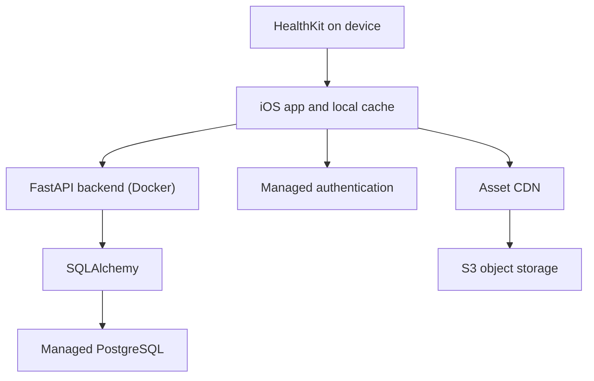

# Movement Forest: V1 Working Specification

Status: planning draft, not a final product or architecture contract  
Document version: 0.9\
Date: 20 October 2026\
Platform: iOS first  
Working title: Movement Forest (name undecided)

This project-root copy is the working specification for future sessions. It incorporates the plant production decisions below and supersedes the older Downloads copy. The practical asset production procedure is [PLANT_ASSET_WORKFLOW.md](PLANT_ASSET_WORKFLOW.md). These documents record requirements and plans; they do not mean the game behaviours have been implemented.

The editable plant/game planning workbook is [Plant_Game_Data.xlsx](outputs/plant-planning/Plant_Game_Data.xlsx). It starts with oak only. Agreed design rules, provisional defaults, illustrative balance examples and undecided values are labelled separately. Editing the workbook does not automatically publish game configuration or change runtime assets.

## 1. Purpose and decision status

This document captures the current concept and a practical implementation baseline. Features, economy, art direction, technology choices and operational policies may change. Recommendations below are proposals, not decisions already made by the founder.

Use these labels throughout development:

- **Agreed:** explicitly established in the planning conversation.
- **Proposed V1:** a concrete default that makes the system implementable, subject to revision.
- **Open:** needs a product or technical decision before the relevant feature ships.
- **Later:** deliberately outside the initial release.

When a decision changes, update this document and add a short decision-log entry. Preserve historical reward and economy versions in the database so changing a rule does not silently rewrite past results.

## 2. Product concept

Users grow a collectible 3D forest through everyday steps. Other iPhone-supported activity metrics and recorded workouts provide additional growth inputs under the scope in section 5.1. Users unbox owned plants through a gacha system. Every result starts at stage 1, sprout, and enters plant storage ready to place in the garden. Plants grow through four stages; users arrange their garden and visit friends' gardens.

The core experience is: move → water/grow individual plants → increase garden attraction → welcome visitors actively or collect a smaller stored return → exchange visitor tokens for seed tickets → draw and place new sprouts → grow and arrange a richer garden. Friends can view the resulting gardens. There is no separate seed growth stage or seed-to-plant conversion on placement. “Attraction,” “visitor tokens,” “seed draw” and “seed tickets” are working names.

### 2.1 Agreed requirements

- Native iOS application with user accounts.
- Steps are the main progression input; workouts provide an optional additional boost, with plant-specific responses by workout type. Other iPhone-supported activity inputs are in the proposed scope in section 5.1.
- A shared garden surface displayed as a 3D board, with continuous placement on its logical 2D ground plane. The working board example is 10×10 garden units; final dimensions remain open. This supersedes the earlier N×N cell-placement requirement.
- Plants have different rarities, properties and four growth stages: sprout, seedling, young plant and adult plant.
- Activity supplies automatic watering/growth. Visitors supply the collection economy: active welcomes and claimed stored visits award visitor tokens, exchanged for seed tickets. Activity no longer directly awards tickets. Spending tokens or tickets never consumes plant growth.
- Every owned plant grows independently, including duplicate species/variant copies. Only placed copies contribute attraction, with higher growth stages contributing more. Attraction and applicable skills determine bounded active visitor opportunities and slower, capacity-limited offline accumulation.
- Active visitors use one shared arrival/flight/tap/departure behaviour. Tapping welcomes a visitor; it does not trap or spend a creature. Offline visits are collected together on return. Capacity skills can extend the time before storage fills; stored value is not lost through absence.
- Each plant lists its supported metric multipliers; omitted metrics are 0 and an explicitly configured 1.0 is neutral. Percentage boosts resolve in two layers: per-activity conversion factors, then one combined-water factor. Weather, events and skills declare which layer they affect.
- Species-specific activity responses are a permanent core requirement: plants can have different step, distance, active-energy, flights-climbed and per-workout-type weights.
- The behaviour model must support conditional modifiers such as weather. Exact weather sourcing and launch scope remain open.
- Each species has a fixed circular reserved-clearance footprint, measured in garden units and shared across its stages and variants. Positions are free within the board where clearance fits; footprint size is independent of screen pixels and growth stage.
- Aim for an attractive garden with approximately 10–15 simultaneously planted plants. This is a composition target, separate from the launch species count and any hard active-plant limit, which remains open.
- Users can drag plants into the garden, rearrange them and return them to storage.
- Individually owned plants have storage outside the garden, displayed with stage- and variant-specific PNG thumbnails. Unboxing creates a sprout directly; no separate seed inventory is needed for this flow.
- Only planted plants receive activity-based growth.
- Stored plants preserve their progress and growth stage without growing.
- Friends can view each other's gardens.
- Client-server architecture; PostgreSQL stores structured state, object storage holds heavier shared assets.
- Backend: Python with FastAPI, SQLAlchemy for database access and Alembic for PostgreSQL schema migrations, containerised using Docker. This replaces Java + Spring Boot.
- Mechanics and architecture remain revisable.

### 2.2 Proposed V1 boundaries

- One garden per user; prototype a 10×10-garden-unit board and tune dimensions against mature plant sizes.
- Single-player garden ownership; friend visits are read-only.
- Continuous ground placement with species-specific circular clearance, rather than rectangular tile occupancy. A plant's visual rotation does not change its circular footprint. Free yaw rotation is proposed; exact controls remain open.
- No plant death or permanent progress loss through inactivity.
- Earned seed draws only; no paid random draws at launch.
- No trading, chat, multiplayer editing, leaderboards or GPS route collection.
- Approximately 10–15 species for the first playable release; final count depends on art workload.
- No continuous passive growth in storage. Activity, rather than elapsed wall-clock time, supplies growth. Water is the presentation unit for activity-driven growth, not a separately decaying moisture resource.
- No watering chores, evaporation, wilting or streak penalties in the proposed watering design. More complex maintenance remains later work. Garden skills are defined in section 6.5; their handlers still need implementation.
- Mature plants continue contributing attraction. No attraction decay, visitor-income penalty for resting, or mandatory daily capture quota. Introductory/permanent visitor milestones are the proposed first quest format; recurring quests and complex synergies are later extensions.

## 3. Core screens and flows

### 3.1 Onboarding

1. Explain the game and show a small example garden.
2. Create or sign into an account through managed authentication.
3. Choose a unique username and display name.
4. Explain why step and workout access are requested, then present HealthKit permission prompts.
5. Establish the activity baseline; do not grant rewards for all lifetime historical activity.
6. Grant a starter sprout in plant storage and guide the user through placing it.
7. Show how movement grows the starter plant and increases its attraction, demonstrate a visitor welcome and token-to-ticket exchange, and explain sync and stored-visit status. The starter garden must support the first draw without requiring a rare plant or another draw first; floor, introductory milestones and tutorial pacing remain to be balanced.

Health access must be optional for account access and viewing the game. If data is unavailable, explain that activity rewards cannot currently update. An empty query result must not be presented as proof that permission was denied.

### 3.2 Garden

- Render shared 3D assets at saved continuous board-local ground coordinates, using the consistent asset-to-garden scale in section 9.
- Camera orbit/pan/zoom with reasonable limits; isometric-style default view is proposed.
- Select a plant to see species, rarity, stage and progress to the next stage.
- Enter edit mode to move, rotate, plant or store plants.
- Preview the plant's reserved-clearance ring on the ground, with clear valid/invalid feedback that does not rely on colour alone. Hide placement guides during normal garden viewing; no permanent tile seams are required.
- Let users inspect an adult-size preview/outline while placing younger stages. Keep its meaning distinct from the smaller reserved-clearance ring; foliage may extend beyond that ring.
- Display resources, unboxing access and last successful activity sync.
- Distinguish pending local edits from server-confirmed state.
- On a visit with newly confirmed activity rewards, present the watering/progress recap described in section 4.4. Reward settlement does not depend on watching an animation.
- Show each selected plant's base attraction and relevant applied modifiers, and an explainable garden attraction summary. Display active visitor availability, stored visits/capacity, estimated time until full, visitor-token balance and ticket exchange access.
- Render server-issued active visitors through the shared visitor controller. An owner's tap requests an idempotent welcome; show pending versus confirmed rewards. Collect stored visits with one short interaction, optionally presenting a swarm. Missed active visitors are not auto-captured or converted into offline storage.
- End active visitor mode when leaving the owner's garden, backgrounding or entering an obstructing edit/modal flow; use the slower accumulation mode for eligible time outside active mode. Cached garden viewing without a connection cannot authoritatively issue or redeem visitors.

### 3.3 Plant storage and placement

- Each unboxed result is an individual owned plant at stage 1, sprout, with zero growth and a stable plant ID. Store species, variant, pinned profiles and progress at award time.
- Filter plants by species, rarity and growth stage.
- Preserve the identity of an owned plant across all storage moves.
- Storage displays the pre-rendered PNG for the plant's current stage and variant. It does not need a live 3D entity or a separately rendered image per owned plant.
- Drag that PNG into the garden; show the matching animated 3D stage model for placement. Newly unboxed plants are sprouts. Returning an older plant to storage preserves its existing stage; dragging it back uses that stage, not a reset sprout.
- Follow the ground plane during the drag and validate the adult-reserved clearance, even for a sprout. A valid release proposes the new position; an invalid release preserves the previous confirmed placement or leaves the plant in storage. Server rejection restores confirmed state and explains the conflict.
- Placement creates or removes a placement record for the existing plant; it never consumes a seed, recreates ownership or resets growth.
- Stored plants retain species, variant, growth stage/progress and identity, and do not grow. Only garden plants need active 3D entities; cached shared model files may remain on disk under the asset cache budget.

### 3.4 Plant unboxing (working API name: seed draw)

- Show the available pool and probabilities before drawing.
- Request the draw from the server; animate the server-selected result.
- On successful commit, award an individually owned sprout directly into storage. A full garden does not block awarding a storage plant. Storage capacity, if introduced, needs an explicit pre-draw validation policy.
- A network retry must return the same completed draw, not roll again.
- A retry must also return the same awarded plant ID, not create another plant.
- Duplicates are separate owned plants with independent growth and attraction contributions while placed. A new duplicate starts as a sprout even if another copy is adult. No shared species progression or prestige is introduced. Breeding or duplicate conversion is later work unless explicitly added to V1.

### 3.5 Friends

- Find a user by exact username or friend code; avoid broad personal-data search.
- Send, accept, decline and cancel friend requests.
- Remove a friend and block a user.
- List friends with basic profiles and lightweight garden summaries.
- Open a friend's read-only interactive garden.
- Default garden visibility: friends-only. Private mode is also supported. Public discovery is later.
- Do not expose step history, workout timestamps or other health records in friend responses.
- Visiting a friend never captures their visitors, spends their storage or earns visitor currency from their garden. Any ambient friend-view insects are non-rewarding visuals.

## 4. Proposed progression model

Exact quantities, rates, probabilities and caps are **open**. Keep them in versioned configuration rather than hard-coded across screens.

| Concept | Proposed role |
| --- | --- |
| Water / activity growth points | One progression quantity, earned automatically by planted plants from movement; not a spendable moisture wallet |
| Plant attraction | Derived from each placed copy's pinned stage-based attraction profile and applicable skills; not currency |
| Garden attraction | Aggregate of placed-copy contributions and eligible garden effects; controls bounded visitor production |
| Stored visits | Slower offline production, limited by effective storage capacity; not spendable until claimed |
| Visitor tokens | Spendable resource awarded by confirmed active welcomes and stored-visit claims; exchanged for seed tickets |
| Seed tickets | Acquired through visitor-token exchange and configured visitor milestone rewards; spent on seed draws |
| Unboxed result | A new individual owned plant at stage 1, sprout; no separate seed item |
| Owned plants | Individual persistent objects with growth and optional placement; stored immediately after unboxing |
| Forest level | Optional long-term collection/expansion system; later unless needed |
| Separate moisture/maintenance meter | Deferred; water currently means activity-driven growth, not a decaying resource |

Working growth design: every eligible planted plant independently evaluates the credited activity through its own versioned behaviour profile, rather than splitting one shared pool between plants. Different species can therefore gain different water/growth from exactly the same movement. Planting more plants does not dilute the other plants' watering. This is the selected planning baseline, subject to future balance review.

Use stable stage IDs in this order: `sprout`, `seedling`, `young`, `adult`. Their display numbers are 1–4; a zero-based implementation index is not a separate seed stage. Sprout starts at zero growth. Keep the remaining three thresholds monotonically increasing and configurable; numeric values remain open. Derive the stage from total growth and a pinned growth-profile version. A stored stage may be used as a cache, but must not disagree with authoritative progress.

Workout water intentionally overlaps ordinary activity water: a recorded run can earn water through daily steps, combined walking/running distance and active energy, plus an additional duration-based running-workout contribution. Do not subtract workout activity from daily totals or add workout measurements into those totals a second time. Workout base rates, plant multipliers and limits are versioned configuration; exact balance remains open.

No reward should require continually beating a personal distance record. Personal weekly goals, daily caps and rest-friendly pacing are economy design options to test.

### 4.1 Automatic watering and basic plant multipliers

**Agreed design direction:** movement waters the planted garden automatically. Each plant's watering/progress meter shows its progress toward the next stage. Water and growth are the same accounting quantity; do not implement both a water wallet and a second growth award for the same credit. Stored plants preserve progress and receive no watering. Progress does not evaporate and inactivity does not kill plants or reset a streak.

Use separate, explicit metric IDs: `steps`, `walking_running_distance_km`, `active_energy_kcal`, `flights_climbed` and workout duration qualified by type, proposed as `workout_minutes.<type>` (for example `workout_minutes.running`). Each supported workout type is a distinct calculation input with its own base rate and plant multiplier; there is no additional untyped workout-duration award. These are proposed internal IDs, not a deployed wire contract. Normalise the quantities before applying plant multipliers. A multiplier of 1.0 means neutral treatment of that metric's configured contribution, not that one step equals one kilometre. Example values for balance exploration only:

| Metric | Normalisation quantity | Example base water per quantity |
| --- | --- | --- |
| `steps` | 1,000 steps | 10 |
| `workout_minutes.<type>` | 10 eligible minutes of the specified type | TBD separately per supported type |
| `walking_running_distance_km` | 1 kilometre | 1 |
| `active_energy_kcal` | TBD kcal | TBD |
| `flights_climbed` | 5 flights | 2 |

All example rates remain unapproved balance values. Only metrics explicitly listed in a plant's behaviour contribute water; omitted metrics, including individual workout types, default to 0. An explicit multiplier of 1.0 gives the normal configured conversion for that metric. Differences by species/variant must be intentional, versioned configuration. Combined walking/running distance, active energy and workout inputs overlap with steps: their contributions are deliberate additional rewards, not claims of independent movement. Balance their combined contribution explicitly. Steps alone must support ordinary progression.

The calculation has two boost layers: first convert each activity into water using its plant multiplier and resolved activity factor; then sum those contributions and apply one combined-water factor. Water is added directly to cumulative growth, with no second water-to-growth exchange rate, consumption or efficiency boost. Growth stage is derived from the resulting total and the configured thresholds. See section 6.6 for formulas and stacking rules.

Workout rewards use deduplicated eligible duration by workout type, not a fixed reward per workout record. For each type, workout water before temporary bonuses is eligible minutes / normalisation minutes × base water for that type × the plant's multiplier for that type. These contributions enter the existing activity layer, then join other metric water before the combined-water factor is applied once. This expands the previous running-only baseline; the exact launch allowlist, type/category mapping, rates and duration caps remain open. Preserve original HealthKit types; any mapping into game categories must be explicit and versioned. Unsupported types receive no workout water until deliberately enabled. Combined walking/running distance intentionally includes both activities and must not be labelled walking-only.

Store cumulative water thresholds in immutable growth profiles: sprout begins at 0, followed by strictly increasing seedling, young and adult thresholds. Numeric thresholds remain blank/TBD until balanced. The water needed for a stage transition is the difference between successive cumulative thresholds, not another separately maintained source of truth. Adult is terminal; cap awarded growth at its configured maturity maximum.

### 4.2 Visitor currency, seed tickets and packet unlocks

**Agreed, superseding step-to-ticket rewards:** movement awards water/growth, not seed tickets or visitor tokens directly. Confirmed active visitor welcomes and claims of stored visits award the working currency `visitor_tokens`. Exchange those tokens for `seed_tickets`; spending either currency never reduces growth or lifetime collection progress. The currencies represent visitor rewards, not butterflies removed from a collection.

Keep spendable currency separate from permanent access:

- **Visitor tokens:** a nonnegative wallet balance backed by a ledger. An active welcome awards its pinned token reward once; a stored-visit claim converts its claimed whole visits under the pinned reward rule once. Exact token amounts remain open. Unclaimed storage is not already in the token wallet.
- **Seed tickets:** acquired through explicit token exchanges and configured visitor milestones, then spent on packets. Use a clear versioned exchange price, stable across player levels within that version; do not automatically raise the ordinary exchange cost as a player levels up. Cost, packet prices and introductory rewards remain TBD.
- **Visitor milestones:** proposed introductory/permanent goals based on authoritative lifetime hosted visits, with explicit rewards. The first goals must be achievable with the starter garden. Increasing later milestone thresholds must not erase progress, change the ordinary exchange price or impose daily attendance. By default both active welcomes and claimed offline visits count once; any active-only objective must say so. Milestone grants do not consume visitor tokens; exchanges do not count as new visits. Recurring daily quests, level-scaled quest generation and a forest-level system are not required for V1.
- **Packet access:** unlocked permanently by versioned cumulative movement, individual-plant maturity and/or explicitly defined visitor milestones. Movement may unlock access but does not pay for draws. Avoid gates requiring a rare random result. Count each owned plant's first maturity once, including duplicates; this is not shared species mastery.
- **Working packet progression:** starter woodland packet available immediately; later packet names, costs, contents, unlock rules, rarity tiers, weights and pity remain TBD. An awarded plant enters storage even when the garden is full.

Evaluate unlocks and milestones from authoritative lifetime counters and unique events, never current balances. Storing plants, exchanging tokens or spending tickets cannot revoke granted packet access. Economy revisions apply prospectively, preserve existing balances/awards and never reroll prior draws.

### 4.3 Personal activity boosts

**Selected design direction, balance pending:** reward unusually active days with modest extra water, without making normal days unproductive. Start with a step-based boost; other metrics can reuse the pattern later when individually balanced. The former direct ticket boost is superseded by the visitor economy.

Reward the extra activity above a personal baseline using marginal bands. Do not retroactively multiply the entire day when a threshold is crossed. Illustration for a 5,000-step baseline:

| Portion of the day | Additional reward on that portion |
| --- | --- |
| First 5,000 steps | None; normal rewards |
| Next 2,500 steps, from 1.0× to 1.5× baseline | +10% |
| Next 2,500 steps, from 1.5× to 2.0× baseline | +20% |
| Steps beyond 2.0× baseline | Normal rewards; no further boosted band |

These band boundaries/rates are illustrative, not approved economy values. The additional boost is bounded by the finite boosted bands; ordinary rewards continue afterwards. Apply the step boost only to step-derived water, not unrelated metric contributions, visitor production or currency. Preserve fractions until settlement/display conversion. Faster growth may improve attraction prospectively when a plant advances stage; it must not retroactively improve past visitor production.

Use recent valid activity days for the baseline, distinguish actual zero activity from unavailable data, and define a floor so a tiny baseline does not create excessive rewards. Lookback length, minimum valid-day count, floor, warm-up behaviour, refresh cadence and exclusions remain open. Freeze the target and profile version before the rewarded day begins; do not move a target during the day or let a late data correction silently rewrite its saved target. If baseline eligibility is unavailable, use neutral base rewards until the chosen warm-up/fallback policy applies. Quieter days incur no reward loss or streak reset.

Calculate the day's cumulative eligible boosted entitlement and subtract already credited entitlement. A sequence of syncs must equal a single sync for the same inputs and pinned contexts. Personal band rates participate in the matching activity layer only for the quantities inside each band; do not multiply every step by the highest reached rate or add another personal-boost multiplier after the activity factor. Apply defined activity-layer, combined-water and any explicit overall limits when boosts combine.

### 4.4 Login watering and progress recap

**Agreed presentation direction; implementation deferred:** on opening/returning to the app, sync new activity and show a short garden-wide watering animation followed by a compact recap of newly confirmed rewards:

- Newly credited activity, water/progress gained per affected garden plant, previous/current stages and any stage advances.
- Newly available stored visits and capacity, shown separately from already claimed visitor tokens. After a confirmed welcome, claim, milestone or exchange, show its visitor-token/ticket changes separately from water; a HealthKit sync itself earns no tickets.
- Personal-boost and garden-skill contributions when applicable. The detailed view can explain individual plants without forcing a long animation sequence.

Show no duplicate reward celebration when opening again without new credits. Bundle multiple changes into one recap; a plant that advances several stages may present its previous and final stage rather than forcing every intermediate animation. Keep rewards durable before presentation, allow skip/interruption and offer reduced motion. Track presentation receipts separately from reward settlement, so a crash or retry never grants rewards again. Offline/delayed sync permits cached garden viewing and a recap once results are confirmed; do not present unavailable activity as zero.

The visual watering is a presentation of credited growth, not an additional growth trigger or a manual claim requirement. Recap water comes from saved per-plant growth credits; UI animation must not recompute rewards from current weather/skills. Stored-visit collection is a separate explicit reward transaction, not a side effect of opening or acknowledging the recap. No recap animation or visitor system has been implemented by the asset work.

### 4.5 Attraction and visitor production

**Agreed design:** each individual placed plant contributes attraction according to its species/variant profile and its own growth stage. Use finite nonnegative configured values, increasing from sprout through adult. Duplicates contribute independently. Stored copies contribute zero, and mature copies remain useful without further growth. Resolve eligible plant-targeted attraction bonuses, sum the contributions, then apply eligible garden-wide bonuses once. Effects must not recursively amplify themselves or count as both plant and garden bonuses unless separate effects explicitly declare both.

Map final attraction to a bounded active visitor probability per configured time slot, with diminishing returns. Provide a useful starter floor and protect against excessive unlucky gaps. **Proposed V1:** floor/pacing protection apply only when at least one plant is placed; an empty garden produces no new visits, while earned currency and existing storage remain claimable. Species footprint, board area, active rate cap and duplicate efficiency must be balanced together to avoid rewarding dense small-plant packing disproportionately. No diversity requirement or complex synergy is implied by the baseline.

Active visitors arrive using a single shared arrival/flight/linger/tap/departure controller. Appearance variants can use data and shared assets rather than bespoke AI classes. The server authorises each opportunity and its reward; a local animation or tap alone cannot create currency. Missed/expired visitors yield no reward and no penalty. Capture/welcome wording and art are open; no mandatory wildlife collection or per-species visitor inventory is introduced.

The attraction function, slot duration, starter floor, gap protection, rates, caps and visitor appearance distribution are **open balance values**. Previous discussion numbers were illustrations, not selected rates. New movement-to-arrival bonuses are deferred; growth increases attraction, and mature planted gardens may continue earning visitors without new movement. No growth, attraction or stored-value decay is introduced.

An illustrative curve family for prototyping, not approved balance, is:

```text
plant_attraction_i = stage_attraction_i × (1 + resolved_capped_plant_bonus_i)
A = sum(placed plant_attraction_i) × (1 + resolved_capped_garden_bonus)
p_active_per_slot = 0 if no plants are placed
                    else max(p_starter, p_max × A / (A + K))
active_expected_visits_per_time = p_active_per_slot / slot_duration
offline_rate = min(offline_rate_cap,
                   offline_fraction × active_expected_visits_per_time
                   × (1 + resolved_capped_offline_rate_bonus))
capacity = min(capacity_max, floor(capacity_base × (1 + resolved_capped_capacity_bonus)))
```

Require `K > 0`, `0 < p_starter <= p_max <= 1` and valid nonnegative rate/capacity parameters. Gap protection alters opportunity timing and must be included when measuring actual active income while respecting the overall issuance caps. Choose offline_fraction/rate caps against observed successful welcomes, including all supported skills; the formula alone does not guarantee that advantage. Empty gardens also have offline_rate zero. Stored amounts and wallets are not clipped by a newly lowered capacity.

### 4.6 Active visitors and slower offline storage

**Agreed design:** active play offers higher earning potential through manual welcomes. Eligible time outside active mode accumulates stored visits at a lower rate, up to a capacity. Offline means the garden is not in active visitor mode; it does not require the server to run a simulation while the app is closed. On return, collect the stored whole visits in one short interaction, optionally shown as a swarm. Do not require one tap per stored visit.

Balance the offline rate below **realistic successful active welcomes**, not merely below the theoretical arrival rate with perfect captures. Capacity and rate are separate: capacity skills extend the absence before storage fills; offline-rate skills fill it faster. Both have configured limits, and rate effects must preserve the intended active-play advantage. Capacity is neither visitor currency nor a maximum wallet balance.

**Proposed V1 accounting:** use server time and settle elapsed inactive intervals into fixed-point stored visits, carrying fractions until a whole visit can be claimed. Each interval uses the attraction/rate/capacity/economy snapshot that was effective during that interval. Stop production at capacity; discard overflow, including overflow fractions, so collecting cannot reveal a hidden backlog. At full capacity nothing expires. If a skill removal reduces capacity below an already earned stored amount, retain that amount and pause production until storage falls below the new capacity. Do not clip earned storage or wallets when a capacity bonus ends.

Use one server-authorised active session per account, with bounded renewable leases and foreground-owner-garden eligibility. Partition server time into nonoverlapping active and inactive intervals; active intervals never also accumulate offline visits. Leaving/pausing closes active mode, and a lost connection expires its lease. Missed active opportunities remain missed; inactivity cannot retroactively convert them into guaranteed stored visits. Only the server decides covered time and issues opportunities; client clocks, repeated opens, reconnects or a second device cannot reroll a covered slot. Define lease duration, heartbeat cadence, opportunity expiry and pause/background handling before release.

Choose one stable server slot grid per garden, not a fresh timer on every session. A slot has at most one decision using its recorded context; entering active mode or changing plants within an already decided slot cannot create another roll. Unpresentable old opportunities are marked missed/expired rather than replayed as a catch-up burst. Pacing protection is durable state, not a resettable client timer.

Before placement, storage, stage advancement, relevant skill/config changes or active-mode transitions change effective attraction/rates/capacity, settle elapsed visitor time under the old snapshot to a single server boundary, then activate the new snapshot for future time. Pending issued opportunities retain their original reward/version until claimed or expired. Late HealthKit growth credits cannot improve already elapsed visitor income. No per-second background job or historical replay under today's garden is required.

### 4.7 Currency exchange and visitor milestones

Every active welcome references a unique issued opportunity, valid owner/session and server expiry. Confirmation consumes that opportunity and atomically awards tokens, increments lifetime hosted counters and records the event. Tapping twice or replaying a request must return the prior result. A server-issued opportunity limits forgery/replays; it is not proof of a human tap or complete bot prevention.

A stored-visit claim first settles eligible time, snapshots the claimable whole amount and its reward lots, then atomically removes those visits, credits tokens and increments lifetime offline/total hosted counters. Each whole stored visit pins its token reward/version when generated; aggregate equal-reward lots so a later rule change cannot reprice already earned whole visits. A shared sub-visit remainder carries across production contexts, with a newly completed whole visit using the reward rule effective when it completes. Fractions remain in storage unless discarded at the cap. A retried claim returns its original result rather than also claiming visits accrued later. Offline visits are aggregate income, not fabricated rare-species captures. Guestbook/species-collection rules would need separate future design.

Token exchange atomically debits the visitor-token wallet and credits the seed-ticket wallet using a disclosed configuration version and a positive integer exchange quantity. Insufficient funds fail without partial changes. Milestone grants use a unique player/logical-milestone identity and record the granted rule version; a new rule version cannot regrant an already completed logical milestone without an explicit new entitlement. Exchanges, claims, quest grants and draws must coordinate wallet locks and idempotency. Record token earning, token spending, ticket earning and ticket spending separately.

## 5. Activity integration and synchronisation

### 5.1 Sources and permissions

The iOS app reads HealthKit on the device. The backend does not log into Apple Health or fetch it directly.

**Proposed V1 tracking scope, selected for specification on 19 October 2026:** four daily cumulative quantities that a compatible iPhone can record without an Apple Watch, plus optional recorded workouts. Request read access for the scoped inputs when their feature is introduced, with a clear explanation of their use.

| Tracked input | HealthKit type | Stored/reporting unit and role |
| --- | --- | --- |
| Steps | `HKQuantityTypeIdentifier.stepCount` | Daily cumulative count; main progression input |
| Walking + running distance | `HKQuantityTypeIdentifier.distanceWalkingRunning` | Daily cumulative metres, normalised to kilometres for water calculation; combined distance, not separate walking/running totals |
| Flights climbed | `HKQuantityTypeIdentifier.flightsClimbed` | Daily cumulative count; plant-specific contribution |
| Active energy | `HKQuantityTypeIdentifier.activeEnergyBurned` | Daily cumulative kcal; estimated activity energy, excluding resting energy |
| Recorded workouts | `HKWorkout` | Session identity, original activity type, start/end, eligible duration in seconds, recording source and optional distance/active energy; activity segments when available |

An Apple Watch is not required for the four daily inputs. iPhone Fitness can estimate active calories from motion data on supported iOS versions; validate the HealthKit read path on the minimum supported iPhone/OS during implementation. Recording depends on hardware, carrying the phone, tracking settings and available source data; this is a capability baseline, not a promise of populated values on every device. A workout may come from a compatible iPhone app, Apple Watch or another source that writes it to HealthKit. Importing workouts does not itself require a game-specific Watch extension.

Exercise minutes, stand time/hours, time in daylight, heart-rate and advanced running metrics are outside this baseline. iPhone can also record walking speed, step length, asymmetry, double-support percentage and walking steadiness on supported devices, but these are sampled/periodic mobility measurements, not cumulative activity counters; they are not included in tracking or water rewards by this decision. A future extension needs a separate purpose, permission and reward policy.

Treat unavailable metrics as unavailable, not proof of zero activity. Base step progression should remain usable when optional inputs are missing. Adding a metric requires its corresponding permission and a clear user-facing explanation.

An HKWorkout's `workoutActivityType` identifies its declared activity. For multisport sessions, use available `workoutActivities` to classify eligible segments by type; count either those segments or a defined parent-workout fallback, never both. Transition/rest eligibility and fallback handling must be explicit. Aggregate walking/running distance alone does not separate walking from running. A user jogging with a phone may produce steps without producing a workout. Any third-party tracker must actually write the workout to HealthKit for this integration to see it.

### 5.2 Sync triggers

- App launch and return to foreground.
- Manual refresh.
- Before a garden membership change, such as planting or storing a plant.
- HealthKit observer notifications with background delivery, when iOS permits execution.

Background delivery is best effort, not a guaranteed cron schedule. Foreground reconciliation must recover from missed notifications, unavailable protected data, network failures and delayed watch syncing. Do not depend on a permanently running app process.

Use HealthKit statistics queries for all four scoped daily quantity totals. Use observer notifications as change signals, followed by reads. Workouts can use anchored queries to process additions/deletions efficiently; persist the local anchor only after durable local processing. Anchors are device-local read cursors, not backend authenticity proofs.

### 5.3 V1 accounting proposal

Use daily activity buckets under a chosen game timezone and a server-maintained rewarded-progress watermark. Report cumulative totals for a bucket, not instructions to add steps.

HealthKit stores timestamped samples rather than clearing a daily counter at midnight. A new date starts a new query/accounting bucket; previous days remain available for reconciliation. Use calendar day boundaries in the chosen game timezone, including daylight-saving transitions, rather than assuming every day lasts 24 hours. Workouts are session records, not resettable daily counters; define and version how eligible duration crossing midnight is attributed before release.

Example: 4,000 reported, then 6,500 reported, then 6,500 retried → only the additional eligible progress between 4,000 and 6,500 is rewarded.

Compute entitlement from the complete current bucket using its pinned economy version. Credit only the increase over the already credited entitlement. This avoids rounding differences between many small syncs and one large sync.

Proposed correction policy: never claw back already granted plant growth or awarded plants when HealthKit revises a total downward. Retain the rewarded watermark; further rewards resume only when entitlement exceeds it. Track observed and credited values separately. This is a forgiving game policy, not a claim that recorded activity never changes.

Reconcile a recent rolling window, proposed seven days, plus unresolved queued uploads. Older historical records remain unrewarded. Initial enrolment requires a baseline so pre-enrolment activity does not become a retroactive reward. Exact baseline and backfill policy must be finalised before implementation.

### 5.4 Which plants receive late activity?

**Proposed V1 policy: credit growth to the garden membership present when the server accepts the activity credit.** Sync available activity before changing membership to minimise surprises.

This policy is intentionally simpler than reconstructing which plants were present at the physical time of every step. A late watch upload may benefit the current garden even if the steps occurred earlier. Explain this in help text and do not promise exact historical attribution.

If exact time-of-activity attribution becomes a requirement, add placement history and time-bucketed movement, then distribute growth over overlapping intervals. That is a different accounting design and should be treated as an explicit future change.

### 5.5 Devices, duplicates and trust

- Never add totals from two phones as if they were separate activity.
- Proposed V1: one active activity-reporting installation per account. Switching it requires a fresh baseline/reconciliation flow.
- Use one consistent HealthKit aggregation strategy; do not naively sum overlapping raw iPhone and Watch samples or add per-source totals together.
- Test multi-source records on real hardware. Do not promise exact equality with the Health app without verification.
- Identify uploaded workouts by HealthKit UUID within the user account. Exact UUID uniqueness handles retries; different apps can still record the same physical session under different UUIDs.
- Detect likely duplicate workouts using overlapping times and source metadata; choose a deterministic policy so a session is not rewarded twice, including overlaps assigned different types. Splitting one session into multiple records must not increase its eligible duration or entitlement. This deduplication applies within workout rewards; intentional overlap with ordinary activity water remains allowed.
- Reject future/out-of-range timestamps and unreasonable payload sizes. Apply configurable reward caps and log anomalies.
- Device data is client-reported and cannot be treated as tamper-proof. Stronger device attestation may raise the cost of abuse but does not prove that steps are genuine.

## 6. Permanent plant behaviour and growth accounting

**Agreed:** plants permanently support different responses to activity and conditional context. This is a core model requirement, not a temporary experiment. Exact coefficients and individual species designs remain open.

### 6.1 Versioned behaviour profiles

Each species references immutable growth, behaviour and attraction profiles/versions. A variant can explicitly override those references; otherwise it inherits species defaults. Resolve and pin all three on each awarded owned plant, including supported garden effects. Each duplicate owns its own progress under those pinned rules. Stage attraction and optional gameplay tags for visitor targeting live in the immutable attraction profile, not in a second mutable per-plant balance. Deploying new profiles for existing plants requires an explicit forward-only migration policy and settlement of elapsed visitor time first.

Use validated JSONB configuration for the rules, interpreted by supported server-side rule handlers. Do not execute arbitrary code or expressions from configuration. Configuration adds new species and coefficient combinations without a new class per species; a fundamentally new effect still needs implementation and tests.

Illustrative oak planning profile (plant multipliers are separate from global metric normalisation/base-water rates; unlisted workout types, active energy and flight metrics contribute 0):

```json
{
  "id": "oak_default",
  "version": 1,
  "metricMultipliers": {
    "steps": 1.0,
    "walking_running_distance_km": 1.0
  },
  "conditionalModifiers": [],
  "gardenEffects": [],
  "unknownWeatherMultiplier": 1.0
}
```

For `system: "growth"` effects, the recipient target identifies which plants receive an effect. Its explicit `scope` separately identifies where it enters the water calculation: `activity` with one metric, or `water` after summing metrics. Visitor effects use a separate explicit system and resolver (section 6.7); they are not a third water layer. Plant behaviour remains a separate permanent coefficient. For an interval with constant context and no personal band crossing:

```text
metric_water = eligible_metric_quantity / normalisation_quantity
               × base_water_per_quantity × plant_metric_multiplier
               × resolved_activity_factor_for_that_metric
plant_water = sum(metric_water) × resolved_combined_water_factor
```

For example, `workout_minutes.running` and `workout_minutes.cycling` may have different plant multipliers; omitted types contribute 0. An activity-scoped workout modifier targets the qualified metric ID, so it cannot silently affect every workout type. Workout duration is an intentional additional water component above ordinary activity, not another contribution to base step/distance/energy totals. Pin units, type mappings, modifier ordering, stacking rules and caps in the rule version. Use fixed-point integer arithmetic, for example micro-growth units, with carried remainders so frequent syncing does not change rewards through rounding. External API growth can remain expressed as display points.

### 6.2 Per-plant settlement

Replace the earlier single garden-wide growth index with direct per-plant growth calculation when new activity is credited. A single universal index cannot represent these varying behaviours adequately.

For each accepted activity credit, within one transaction:

1. Lock the garden accounting state and settle elapsed visitor time under the old attraction snapshot, then snapshot placed plants, their pre-credit stages and pinned profiles under the credit-time policy.
2. Collect eligible growth-system species, garden-skill and event effects from that same snapshot/context and route each effect to its declared activity or water scope.
3. Convert each eligible metric with its normalisation and plant multiplier, resolving activity bonuses within personal/context bands before summing.
4. Apply the single resolved combined-water factor, defined overall limits and remaining-maturity clamp, carrying fractional remainders. Use the same snapshot for all recipients so processing order cannot change the outcome.
5. Save accumulated growth and the growth-credit record for each affected plant. At the server boundary, refresh attraction/visitor-skill eligibility from the new stages for future time only; elapsed visitor rewards and the batch's pre-credit growth effects stay fixed.

Stored plants are not evaluated and do not grow. Moving a plant never recreates it or resets growth. A plant at 240 points stays at 240 in storage, then resumes when replanted. Rearranging it within the garden does not change its growth balance.

Garden area and positive species clearance radii constrain packing, but continuous placement no longer provides the earlier 100-cell/100-plant bound. Target approximately 10–15 planted plants for composition and prototype workload; define and load-test an explicit supported maximum before release. Whether the game also enforces a hard active-plant limit remains open. Small-footprint species can fit in greater numbers, and each still receives independent watering, so footprint sizes also need economy review. Batch writes and measure performance; do not introduce separate index systems before a demonstrated need. No job updates every plant every minute. Activity syncs create growth; elapsed time alone creates none.

### 6.3 Typed activity credits and correction handling

Preserve separate input dimensions: eligible steps, combined walking/running distance, active energy, flights climbed and deduplicated workout duration by supported type. Maintain per-metric credited watermarks and durable workout/segment credit identities, not one already-converted universal growth entitlement. Do not award both a typed workout duration and an untyped total for the same minutes. Apply nonlinear caps to cumulative eligible quantities before deriving new credit, so rewards do not depend on sync frequency.

HealthKit credits award plant growth and cumulative activity/unlock progress, not currency. Remove the former step-derived ticket entitlement/watermark from this model. Visitor events, exchanges and milestone grants own currency accounting. Retry and downward-correction policies still apply per metric/workout. A unique `(plant_id, activity_credit_id)` prevents repeated growth from the same accepted credit.

### 6.4 Weather and contextual modifiers

Weather-dependent behaviour is part of the supported design. Its provider, location policy, time resolution, cost and whether live weather ships in the first release are open. Do not treat missing weather as clear skies; use the defined neutral fallback and show no punitive penalty for unavailable context.

Weather is a condition/source of effects, not a mandatory third multiplier layer. A rainy-step conversion bonus declares `scope: "activity"` and `metric: "steps"`; a rainy-day bonus to total plant water declares `scope: "water"`. Skills and in-game events follow the same contract. Evaluate matching conditions first, then include their bonus fractions in the appropriate layer's aggregation, rather than multiplying a separate weather/event factor on top.

Two distinct policies must not be confused:

- **Activity-time weather:** match time-bucketed activity to weather observations for that time and selected location. Daily totals alone cannot tell how many steps occurred during rain.
- **Credit-time weather:** use weather when the server credits activity. Easier, but users could delay syncing to change outcomes. Do not silently implement this as activity-time weather.

Proposed intended policy is activity-time weather, combined with the existing credit-time garden membership policy. Persist provider, coarse location reference, observation interval, normalised condition and retrieval time for reproducibility. Cache weather by region/time, not per plant or per user request. Do not request GPS routes solely for this mechanic.

If location is needed, choose explicitly between an opt-in coarse current location and a selected home region. Neither proves that a user exercised outdoors. Rain bonuses can include indoor walking; avoid making severe weather exposure a requirement.

Late weather enrichment must not rerun all historical plant rules using current placements. Proposed default: settle once with known context or neutral fallback, and make the outcome final. If retroactive bonuses are later desired, credit the original plant recipients using recorded context and unique adjustment IDs.

Neighbour effects, individual traits and maintenance gates are supported extension directions, not implemented merely by having JSONB. Each needs a defined evaluation order, snapshots and versioned handlers before use. Garden-wide legendary skills now have the explicit proposed design below.

### 6.5 Placed-plant garden skills

Plants with explicitly configured garden skills may emit passive effects while placed, including legendary growth skills and attraction/offline-storage skills. Stored sources are inactive. Rarity does not automatically grant an ability. Oak currently has no assigned garden skill. Solar-reed is a design example only, not a new species entry or produced asset. Which real species receive visitor skills remains open.

Example skill: **Sunlit Garden** gives every planted plant, including its source, +10% activity-derived water when the applicable weather is sunny. Its magnitude is illustrative. It does not grant water without eligible activity, produce visitor tokens or multiply tickets. Visitor skills must declare their separate system/scope. Unknown weather yields neutral growth.

Store effects inside the existing immutable behaviour profile, with validated fields such as:

```json
{
  "gardenEffects": [{
    "id": "sunlit_garden",
    "system": "growth",
    "type": "growth_bonus",
    "condition": { "weather": "sunny" },
    "target": "all_planted_plants",
    "scope": "water",
    "bonusFraction": 0.10,
    "stackingGroup": "sunlit_garden",
    "stackingRule": "strongest",
    "affectsTickets": false
  }]
}
```

An optional minimum activation stage must be explicitly configured; sprout versus maturity activation remains undecided. Until it is chosen for a real skill, that skill is not launch-ready. Evaluate activation using pre-credit stages. Reaching the activation stage during a settlement enables it for subsequent credits, never earlier recipients in the same batch.

Working growth stacking policy: growth-system skills enter the same two layers as other growth effects, rather than creating a third water multiplier. Within the chosen scope/metric and recipient, use the strongest eligible effect in each shared stacking group, add the resolved fractions from distinct groups and clamp the layer to its configured cap. Caps remain TBD. Example 10% and distinct 5% water-scoped effects yield a combined-water factor of 1.15 when both apply. Multiple copies of the same skill do not add indefinitely. Define tie-breaking deterministically and retain source plant IDs for explanation. Keep an active mature source's skill eligible even when the source itself can gain no more growth. Visitor-system stacking is specified separately in section 6.7.

Do not mutate stored base plant multipliers when an aura activates. Resolve an effective modifier for that settlement. Compute garden effects from the bounded garden snapshot, not once per plant with repeated weather/network calls, and never recursively trigger skills from skill-awarded water.

Current working timing combines **credit-time garden membership/skill-source stages** with **activity-time weather**, as in section 6.4. An activity interval spanning different weather needs corresponding time-bucketed input; daily totals alone cannot attribute sunny steps. Placing a legendary before a later sync can therefore affect newly credited older activity. Foreground sync before membership edits reduces this but cannot eliminate delayed uploads. Requiring presence at movement time would need placement/stage history and historical settlement, a larger future design change. Do not claim the simpler policy provides historical presence guarantees.

Record applied skill IDs, profile versions, source plants, relevant weather/event snapshots, effective factors and the actual awarded bonus in growth-credit context. Retries reuse the original result; later weather enrichment or skill changes do not rerun past awards. An independently managed ability catalogue can be added later if required; a separate skill table is not necessary for this initial profile-based design.

### 6.6 Two-layer boost calculation and versioned settlement

**Agreed calculation structure:** activity → water → cumulative growth/stage. There are two percentage-boost layers, not two separately awarded currencies. Each plant has one resolved activity factor per metric and one resolved combined-water factor for a given settlement context. The final water amount is the amount added to cumulative growth, subject to maturity limits.

| Element | Role | Neutral / missing behaviour |
| --- | --- | --- |
| Base conversion rate | Global water per unit of the metric | Explicit versioned configuration |
| Plant behaviour multiplier | Permanent plant coefficient for that metric | Explicit 1.0 is neutral; omitted/0 disables the contribution |
| `activity`-scoped bonus | Changes one metric's conversion to water | No eligible bonuses gives factor 1.0 |
| `water`-scoped bonus | Changes the sum of all activity-water contributions | No eligible bonuses gives factor 1.0 |

#### Effect metadata and routing

Every percentage effect declares `system`, recipient `target`, `scope`, `bonusFraction`, `stackingGroup`, `stackingRule` and supported optional condition/activation rules. This section governs `system: "growth"`: activity scope must declare one canonical `metric`; water scope has no metric selector. A rule intended to affect several selected metrics expands into explicit per-metric effects. Effect identity/profile version and provenance identify its source separately from its calculation scope. Reject undeclared/unknown system-scope combinations; never route an attraction or storage effect through the water resolver.

For example, an event that adds 20% step conversion can be represented as:

```json
{
  "id": "step_event_bonus",
  "system": "growth",
  "type": "growth_bonus",
  "target": "all_planted_plants",
  "scope": "activity",
  "metric": "steps",
  "bonusFraction": 0.20,
  "stackingGroup": "step_event_bonus",
  "stackingRule": "strongest",
  "affectsTickets": false
}
```

Scope identifies where the effect applies; it is not inferred from the word weather, event or skill. Each effect applies once at its declared layer. A skill may deliberately emit separate effects in both layers, but they need distinct effect IDs and explicit configuration. Do not apply the same effect twice. Base plant multipliers are not added to temporary bonus fractions or mutated by them.

#### Stacking within and between layers

For each recipient and applicable context/band, resolve the strongest eligible bonus per `(scope, metric if applicable, stackingGroup)`, add the fractions from distinct groups, apply that layer's bonus cap and add 1 to obtain its factor. Water scope has one shared pool of percentage bonuses across weather, events and garden skills. Activity scope has a separate pool for each metric. Caps are configured as bonus fractions; exact per-metric activity caps, combined-water cap and any additional overall reward limit remain open.

Two distinct +10% and +20% activity bonuses resolve to 1.30 before caps, not 1.10×1.20. An activity factor and the combined-water factor deliberately multiply across layers: 10 base water ×1.20 activity ×1.10 water = 13.2 water before any limits. A +10% combined-water effect applied to 10 unboosted water gives 11. With several metrics, sum their independently converted water first and apply the combined-water factor once.

#### Marginal personal boosts and contextual buckets

Personal spike bonuses are activity-scoped band rules, not a fixed percentage applied to the whole day. Split newly eligible metric quantities at personal-band and context boundaries. For each resulting portion, resolve the applicable bonus fractions, including that portion's personal rate, under the same grouping/cap rules. Do not first multiply by a personal factor and then multiply by another activity factor; temporary percentages add within that layer after group resolution.

```text
rate_i = base_water_per_normalisation_quantity_i / normalisation_quantity_i
plant_i = configured_metric_multiplier_i, or 0 when omitted
activity_factor_i,b = 1 + capped resolved activity bonus for metric i, band/context b
metric_water_i = sum_b(quantity_i,b × rate_i × plant_i × activity_factor_i,b)
water_factor = 1 + capped resolved water-scoped bonus
calculated_water_for_context = sum_i(metric_water_i) × water_factor

awarded_water = min(calculated water after explicit overall limits, remaining maturity)
new_cumulative_growth = previous_cumulative_growth + awarded_water
new_stage = stage derived from new_cumulative_growth and pinned thresholds
```

The formula for one context is repeated/summed for distinct pinned contexts when factors differ; do not apply today's water factor to the entire historical day's activity. Maturity clamping occurs at the final maturity maximum, not at every intermediate threshold: one valid credit may advance multiple stages. No further water-to-growth multiplier is applied.

Ordinary percentage bonuses cannot enable a metric whose plant multiplier is zero, or create water without eligible activity. Fixed water grants, changing a plant's supported metrics, conversion redirection and other special mechanics require separately supported handlers and explicit ordering; do not disguise them as percentage boosts. Those mechanics are not implied V1 features.

Currency accounting is separate. Activity/water bonuses, including personal step boosts, never directly mint visitor tokens or tickets. Attraction and storage skills affect prospective visitor production through section 6.7, not the visitor-token exchange price or direct wallet awards. Any future currency effect needs a separately approved economy rule and handler.

Use fixed-point arithmetic with carried remainders and defined final rounding. Cumulative bonus/cap evaluation must use the same frozen daily targets, per-metric watermarks and pinned context segments so splitting a sync cannot increase rewards. Record input quantities, base plant coefficients, resolved per-metric/band factors, post-activity water subtotal, combined-water factor, cap/maturity adjustments and actual award with effect/source/profile references. Preserve settled contexts on retries and later updates; never rerun past awards under new weather, events or newly placed skills. Exact contextual bucket handling must be tested before live conditions/skills launch.

### 6.7 Attraction profiles and visitor skill resolution

**Proposed V1 implementation of the agreed visitor design:** `attraction_profiles` contain immutable per-stage base attraction in fixed-point units and optional gameplay tags. At award, resolve the variant's attraction override or the species default and pin it on the owned copy. Attraction is a derived value: stage lookup → eligible plant-targeted effects → garden sum → eligible garden-wide effects. Do not persist a mutable attraction balance on each copy or use client-reported totals as authority.

Visitor effects declare `system: "visitors"` and one supported scope:

| Scope | Target and calculation |
| --- | --- |
| `attraction_plant` | Selected placed plants; percentage bonus to their stage attraction before summing |
| `attraction_garden` | Owner's garden; percentage bonus applied once after the sum |
| `offline_rate` | Owner's garden; percentage bonus to the slower storage-production rate, subject to its rate cap/active-income constraint |
| `offline_capacity` | Owner's garden; percentage bonus to base stored-visit capacity, subject to a configured maximum; final capacity rounds down to a whole visit |

These scopes have no activity `metric`. Plant filters may explicitly target species/variant or pinned gameplay tags. Activation uses the source's settled stage and requires it to be placed. Any synergy needs a supported declarative condition, an evaluation order and a version; accepting arbitrary executable expressions or promising all synergy types is outside V1. Begin with simple attraction/capacity effects; exact offline-rate skill launch scope remains open.

For each `(system, scope, recipient, stackingGroup)`, choose the strongest eligible effect, add distinct-group bonus fractions, then apply that scope's configured cap. Break ties deterministically and retain source IDs. Duplicate skills in the same group do not stack; an explicit cross-variant shared group prevents variant-based aura multiplication. An effect enters exactly one declared scope. Plant and garden layers deliberately compound only when separately configured; no recursive skill triggers. Base per-copy attraction from duplicates remains additive even when their duplicate auras do not stack.

Persist enough context to explain each visitor-production segment: placed source IDs, stages/profile versions, base/final attraction, resolved bonuses, rate/capacity, applicable config versions and server interval. After any relevant state change, close the old segment before opening the next. Missing optional context is neutral; initially avoid live-weather visitor conditions, which would require a separate historical interval policy. Growth weather semantics must not silently be reused for elapsed visitor production.

## 7. System architecture



### 7.1 Technology baseline and decision status

| Layer | Choice | Rationale / status |
| --- | --- | --- |
| iOS UI | Swift and SwiftUI | Native HealthKit integration; proposed |
| 3D rendering | RealityKit behind a garden-renderer interface | Prototype ground picking, continuous dragging, camera controls and a mature 10–15-plant garden on the minimum device; test the supported maximum before committing |
| Local persistence | SwiftData or SQLite-backed repository | Cache server state and durable sync queue; exact library open |
| Backend | Python + FastAPI modular monolith | Agreed framework; replaces Java + Spring Boot. Modular-monolith organisation remains proposed |
| Database access | SQLAlchemy | Agreed ORM and SQL access layer; explicit transactions preserve ownership, reward and wallet invariants |
| Schema migrations | Alembic | Agreed migration tooling for the PostgreSQL schema; version-controlled revisions |
| API | HTTPS JSON REST | Simple request/response and retry semantics |
| Database | PostgreSQL; managed hosting proposed | Agreed database engine; transactions, relational ownership and durable state |
| Authentication | Managed provider with Sign in with Apple support | Avoid implementing password handling; vendor open |
| Assets | S3 + CloudFront or equivalent CDN | Shared, versioned binary content |
| Deployment | Docker containers; one API service in one region proposed | Docker is agreed; hosting vendor remains open. Expand replicas after load evidence |

FastAPI, SQLAlchemy, Alembic, PostgreSQL and Docker are agreed technology choices. Other entries remain proposed or open as labelled; no infrastructure has been provisioned by this specification. Microservices, Kubernetes, Redis and a message broker are not V1 requirements.

### 7.2 Responsibility split

Client: HealthKit reads, scene rendering, input, placement preview, cache, offline viewing and durable upload queue; shared visitor animation, active-session lifecycle signals and pending/confirmed welcome/claim presentation.

Server: authentication verification, permissions, canonical garden state, placement validation, activity accounting, derived attraction, visitor time/mode settlement, opportunity issuance/expiry, offline storage, currency ledgers/exchanges/milestones, randomness, inventory and friend relationships.

Database: source of truth for game state. S3 is the source for shared asset binaries, not per-user progress. Clients never receive database credentials or cloud storage write credentials.

### 7.3 Backend implementation baseline

FastAPI exposes the HTTPS JSON REST API. Keep game rules and transactional use cases in application/domain modules, with SQLAlchemy handling persistence. Separate request/response schemas from ORM models so database changes do not implicitly change the client contract.

Use a request-scoped SQLAlchemy session with explicit transaction boundaries for mutations. A growth/visitor settlement, welcome, stored-visit claim, exchange, milestone grant, draw or placement operation must commit related state changes atomically, rolling back on failure. Establish one consistent lock order across garden accounting and wallets. Existing idempotency, locking, version-check and constraint requirements still apply; choosing an ORM does not replace them. The synchronous/asynchronous database access mode and PostgreSQL driver remain implementation decisions.

Alembic owns schema evolution through reviewed, version-controlled migrations. Do not use ORM table auto-creation as the deployment migration mechanism. Runtime API containers and the migration command use the same application image; run migrations once as a controlled deployment step before starting the compatible API release, rather than independently from every API replica.

## 8. PostgreSQL data model

Names and types below describe a migration-ready design direction, not final executable DDL. Use UUID primary keys for user-owned records, `timestamptz` for instants, integer/bigint counters and foreign keys. Use relational columns for invariants and joins; reserve JSONB for flexible metadata/configuration.

Implement this model with SQLAlchemy mappings and Alembic revisions targeting PostgreSQL. Preserve the specified PostgreSQL types, foreign keys, checks and unique/partial indexes in the migrations; application validation supplements database constraints. Verify migrations and transaction behaviour against PostgreSQL.

### 8.1 Identity and social tables

| Table | Key fields and constraints |
| --- | --- |
| `users` | `id uuid PK`, `auth_subject text UNIQUE`, `username text`, `display_name text`, `avatar_key text NULL`, `game_timezone text`, `status text`, `created_at`, `updated_at`; unique case-normalised username index |
| `activity_devices` | `id uuid PK`, `user_id FK`, `installation_id`, `is_active boolean`, enrolment/baseline timestamps; partial unique active-device index per user |
| `friendships` | `id uuid PK`, `user_low_id FK`, `user_high_id FK`, `requested_by FK`, `status text`, timestamps; unique canonical user pair, disallow self-pair; status pending/accepted |
| `blocks` | `blocker_id FK`, `blocked_id FK`, `created_at`; composite PK, disallow self-block |

Blocking overrides friendship and visibility. Remove/disable conflicting requests when blocking. Declined/cancelled requests can be deleted; retain audit events only if needed.

### 8.2 Garden and collection tables

| Table | Key fields and constraints |
| --- | --- |
| `gardens` | `id uuid PK`, `owner_id FK UNIQUE`, `width numeric(9,3) CHECK > 0`, `depth numeric(9,3) CHECK > 0` in garden units, `visibility text`, `layout_version bigint`, `state_version bigint`, timestamps; width/depth describe ground extent, not elevation or cell counts |
| `plant_species` | `id text PK`, name/description, `clearance_radius numeric(9,3) CHECK > 0` in garden units, default growth/behaviour/attraction profile references and versions, enabled flag, optional descriptive `properties jsonb`; one shared circular radius for all stages/variants; no owner or individual progress |
| `plant_variants` | `(species_id, variant_id) PK`, display name/description, rarity, optional growth/behaviour/attraction profile overrides, enabled flag, immutable asset-catalogue reference; standard/blue/vined are oak's current visual variants. Overrides resolve before pinning on award; rarity is shared variant configuration, not rolled per-copy stats |
| `growth_profiles` | `(id, version) PK`, `thresholds jsonb`, maximum growth; immutable once used |
| `attraction_profiles` | `(id, version) PK`, immutable nonnegative `stageAttractionMicroUnits` for all four stages, strictly increasing for the V1 growth incentive, optional pinned gameplay tags for visitor targeting; no user state or currency |
| `growth_rule_profiles` | `(id, version) PK`, validated immutable `metricMultipliers` (omitted metrics = 0), `conditionalModifiers` and `gardenEffects` JSONB; effects declare `system` growth/visitors, supported scope, recipient/filter, conditions/activation and stacking metadata. Growth activity scope requires a canonical metric; growth water and visitor scopes forbid one. Schema version and activation metadata; an empty effects array means no emitted skills |
| `plant_stages` | Species/variant/stage reference, visual model key, PNG thumbnail key and stage display metadata; four stable stage IDs |
| `owned_plants` | `id uuid PK`, `owner_id FK`, `(species_id, variant_id) FK` to shared variant, resolved/pinned growth/behaviour/attraction profile references and versions, `growth_micro_units bigint CHECK >= 0` representing individual cumulative water, fractional accounting state if needed, acquisition source/reference, `first_matured_at NULL`, timestamps; stage and base attraction derived from that copy's progress and pinned profiles, not separate authoritative balances. Duplicate copies have distinct IDs and progress |
| `garden_placements` | `plant_id FK PK`, `garden_id FK`, `x numeric(9,3)`, `y numeric(9,3)` in board-local garden units, `rotation_degrees numeric(5,2)` with `0 <= value < 360`; a plant has at most one placement; coordinates are the ground-centred anchor, not a rectangle corner |
| `wallets` | `(user_id, currency_code) PK`, `balance bigint CHECK >= 0`; V1 currencies `visitor_tokens` and `seed_tickets`, in whole units. No water wallet, implicit step-to-ticket balance or offline-storage balance duplicated here |
| `economy_configs` | `version PK`, immutable water normalisation/base rates and caps, personal-water-boost policy, attraction/visitor curve parameters and caps, starter floor/gap protection, active slot/lease/expiry policy, slower offline rate/capacity rules, token reward rules, token-to-ticket exchange cost, milestone rules, rounding/grouping policies and activation time. No direct step-to-ticket rate; changes apply prospectively |
| `gacha_pools` | `(id, version) PK`, packet name/description, immutable weighted species/variant outcomes, ticket cost, unlock-rule JSONB/version, active flag; separate packet access from purchase |
| `gacha_draws` | `id uuid PK`, `user_id FK`, pool/version, economy version, cost, result species/variant, awarded `plant_id FK UNIQUE`, `request_id`, timestamps; unique `(user_id, request_id)` |
| `player_progress` | `user_id FK PK`, cumulative eligible movement, unique first-maturity counts, lifetime active/offline/total hosted visits and milestone aggregates, version/timestamps; derived from unique confirmed events and independent of wallet spending. A stored visit counts as hosted on claim, not both on accrual and claim |
| `packet_unlocks` | `(user_id, pool_id) PK`, granted_at, unlock-rule version and supporting milestone/context reference; permanent access, never revoked by storage moves or ticket purchases |

No separate storage-location flag is required: an owned plant without a placement is stored. Unboxing creates this owned plant immediately. No separate `seed_inventory` table is required for the agreed flow. Never maintain two conflicting sources of truth for location. Validate owned species/variant combinations against the variant catalogue; rarity and probabilities are configuration, not extra model geometry.

Placement schema rules: `clearance_radius`, dimensions and placed transforms are required, finite values in their supported ranges; an enabled/placeable species must have an approved positive radius. A draft radius may remain TBD in the planning workbook, but cannot be published as a valid placeable species. Neither `owned_plants`, `plant_stages` nor `plant_variants` stores a duplicate radius. Do not accept a radius, scale override or collision result supplied by a client as authoritative. Per-model bounds remain separate art metadata and are not the clearance radius.

The decimal types and precision above are **Proposed V1 implementation defaults**, not additional approved balance values. They support visually continuous placement at 0.001-garden-unit precision. Clients and server must use the same canonical precision and geometry rules described in section 9. The garden-unit/asset-scale convention is published in versioned game configuration and exposed by bootstrap/catalogue responses. Published radius, unit-scale or board-dimension changes require an explicit compatibility/migration policy and revalidation of affected layouts; never silently invalidate a planted garden or remove plants to make it fit.

Planning workbook mapping: replace `Footprint (tiles)` with `Clearance radius (garden units)`. Each Plants row edits the species radius; leave oak's actual value TBD until adult composition review. Record circular shape, fixed-through-growth policy, continuous placement and the 10–15-plant visual target in Game Rules. Attraction profiles, visitor skills and economy rules will need matching authoring fields when the workbook is next updated. The workbook has not been changed by this specification update; older step-ticket fields are superseded, not runtime rules. The workbook does not own per-user coordinates or derive clearance from thumbnail pixels.

### 8.3 Activity, rewards and request tables

| Table | Key fields and constraints |
| --- | --- |
| `activity_days` | `(user_id, game_date) PK`, timezone, UTC bucket boundaries, observed daily steps, combined walking/running distance, active energy and flights climbed, availability flags, per-metric enrolment baselines and credited watermarks, frozen personal baseline/target and water-boost-profile snapshot/version, economy version, last observation time; workout duration aggregates derive from deduplicated session/segment credits. No step-derived ticket watermark |
| `workout_imports` | `id uuid PK`, `user_id FK`, `healthkit_uuid`, source metadata, original HealthKit type, mapped game type and mapping version, start/end, recorded and eligible duration seconds, distance metres nullable, active energy kcal nullable, optional typed segment references/data, status, bonus credited, duplicate-group reference; unique `(user_id, healthkit_uuid)`; retain segment identities and credited attribution when splitting by type/day, with no second parent-duration award |
| `activity_credits` | `id uuid PK`, user/garden, source key, eligible input quantities, time interval, input revision, rule/economy versions and optional weather-context reference; unique logical input credit |
| `plant_growth_credits` | `(plant_id, activity_credit_id) PK`, pinned behaviour version, before/after cumulative growth and stage, quantities/plant coefficients and per-metric/band activity factors, post-activity water subtotal, combined-water factor, input/context/effect/source references, cap/maturity adjustments and actual-awarded growth micro-units, created_at; breakdowns must reconcile to the final award without double-counting cross-layer bonuses |
| `weather_contexts` | `id uuid PK`, coarse region key, provider, observation interval, normalised condition, retrieval time; shared cached observations, no precise route |
| `reward_events` | `id uuid PK`, user, garden, reason, source key/revision, economy version, aggregate growth summary, resource delta JSONB, accepted_at; unique logical credit key |
| `wallet_entries` | `id uuid PK`, user/currency, signed amount, reason, source event/request, timestamp; append-only ledger |
| `api_requests` | `(user_id, request_id) PK`, operation, payload hash, status, stored response, created_at; idempotency record |
| `reward_recaps` | `id uuid PK`, user, covered reward-event references, immutable recap payload/reference, presentation acknowledgement and timestamps; presentation/acknowledgement never issues rewards |
| `garden_visitor_state` | `garden_id FK PK`, owner reference, `settled_through_at`, fixed-point `stored_visits_micro_units CHECK >= 0`, current context reference, active-session reference nullable, stable active-slot cursor/gap-protection state, state version; storage can temporarily exceed a newly reduced capacity without loss. Exactly one accounting timeline per garden |
| `visitor_storage_lots` | `(garden_id, token_reward_version) PK`, nonnegative whole stored-visit count and pinned tokens per visit; these counts plus the state's sub-visit remainder reconcile to aggregate stored visits. Generation creates whole visits at the then-effective reward version; claims debit lots and retain their reward breakdown, never reprice old whole visits |
| `visitor_contexts` | `id uuid PK`, garden, effective server boundary, economy version, source/profile/stage snapshot, base/final attraction, effective active curve/rate, offline rate/capacity and resolved skill provenance; immutable. Consecutive boundaries plus settlement records identify historical intervals |
| `visitor_sessions` | `id uuid PK`, user/garden/device, server start/end, lease expiry, status; at most one active session per account, with durable nonoverlapping active coverage. Closed coverage remains auditable after session end |
| `visitor_settlements` | `id uuid PK`, garden, interval start/end, mode, context reference, covered slot range, generated/stored/discarded fixed-point amounts, before/after storage, logical key UNIQUE; serialise on visitor state so intervals/slots are never processed twice |
| `visitor_opportunities` | `id uuid PK`, session/garden/owner, stable slot identity UNIQUE per garden, visual visitor key, issued/expires timestamps, pinned context and token-reward version/amount, status issued/welcomed/expired and welcome-event reference UNIQUE nullable; issued randomness/outcome cannot reroll on retry |
| `visitor_reward_events` | `id uuid PK`, user/garden, source kind active_welcome/offline_claim, source ID UNIQUE within kind, claimed visit count, total tokens and pinned opportunity/reward-lot breakdown, before/after storage when applicable, server timestamp; one event drives ledger entries and lifetime hosted counters |
| `token_exchanges` | `id uuid PK`, user, request ID UNIQUE per user, exchange config version, positive integer quantity, total token debit and ticket credit, linked ledger/reward references; immutable completed result |
| `visitor_milestone_grants` | `id uuid PK`, user, logical milestone ID, granted rule version, authoritative threshold/event context, reward references and timestamp; UNIQUE(user, logical milestone ID) prevents retries/version edits regranting a completed entitlement |

A reused request ID with a different payload must fail. Keep durable draw/reward uniqueness even if short-lived API response records are cleaned up.

These are proposed logical records, not applied migrations; implementation may consolidate records if uniqueness, audit and concurrency guarantees remain explicit. Profiles carry skill definitions; a separate ability table is optional later. Keep shared authoring metadata (descriptions, rarity, multipliers, stage attraction/thresholds, packet rules and effect definitions) in validated catalogue/configuration records. Keep individual ownership/growth, visitor state/claims, token/ticket balances, daily targets, grants and recap receipts in player state. The Excel workbook is a planning source, not a live database or automatic configuration deployment.

Indexes: plant owner; placement garden; both friendship user columns plus status; incoming pending requests; activity day/user; workout user/start; reward/ledger user/time; visitor session owner/status; opportunity owner/status/expiry; settlement garden/time; milestone owner/logical ID. Paginate collections and friends. Avoid indexing every JSON field before query evidence warrants it.

### 8.4 Example API garden representation

```json
{
  "gardenId": "example-garden-id",
  "width": 10,
  "depth": 10,
  "coordinateUnit": "garden_unit",
  "coordinatePrecision": 3,
  "gardenUnitMetres": 1,
  "layoutVersion": 12,
  "stateVersion": 48,
  "catalogVersion": "1",
  "plants": [{
    "plantId": "example-plant-id",
    "speciesId": "moonwillow",
    "variantId": "default",
    "growthPoints": 240,
    "growthStage": "seedling",
    "x": 3.2,
    "y": 4.6,
    "rotationDegrees": 35
  }],
  "lastActivitySyncAt": "2026-10-16T16:30:00Z",
  "ownerVisitorSummary": {
    "contextId": "example-visitor-context-id",
    "totalAttraction": 28,
    "mode": "inactive",
    "storedVisitsMicroUnits": "12500000",
    "claimableWholeVisits": 12,
    "effectiveCapacityVisits": 30,
    "activeSessionId": null
  }
}
```

IDs above are illustrative strings; actual IDs follow schema UUID requirements. All geometry, attraction, storage and capacity values are illustrative/proposed, not final balance. The visitor summary illustrates display/accounting fields independently of the single sample plant; a real response derives its total from its complete garden snapshot. X/Y are both ground coordinates. Species clearance radii come from the matching catalogue version, not this placement payload. Friend DTOs use the same geometry/scale convention and omit `ownerVisitorSummary`, private activity/sync details and internal ledger values. `depth` replaces the earlier ambiguous ground `height` field; `rotationDegrees` makes angle units explicit.

### 8.5 Example species footprint contract

The game catalogue exposes the species' placement definition separately from individual placement state. Proposed API shape (illustrative radius only, not a balanced oak value):

```json
{
  "speciesId": "oak",
  "footprint": {
    "shape": "circle",
    "clearanceRadius": 0.9,
    "unit": "garden_unit",
    "fixedAcrossStages": true,
    "sharedAcrossVariants": true
  }
}
```

`clearanceRadius` maps to `plant_species.clearance_radius`; the shape and fixed/shared flags express V1 invariants rather than independent editable stage/variant values. An individual move sends plant identity, X/Y and yaw, never an override footprint. The game catalogue's version identifies these placement rules. The art package catalogue instead describes units, anchors, actual model bounds and fixed-footprint compatibility; it does not become a second authority for gameplay clearance.

### 8.6 Shared species/variant definitions versus owned copies

One shared species has many shared variants; many user-owned copies can reference the same `(species_id, variant_id)`. No class or table per botanical species is required. Data-driven profiles configure one generic owned-plant model and the supported rule handlers.

| Shared catalogue/configuration | Individual player state | Derived owner-facing fields |
| --- | --- | --- |
| Species ID/name/description, enabled state and circular clearance | Plant UUID and owner UUID | Current stage and remaining water to next stage |
| Variant ID/name/description, rarity, enabled state and asset catalogue | Species/variant references and resolved pinned profile versions | Current model/thumbnail selected by species/variant/stage |
| Immutable growth thresholds and terminal maximum | Cumulative growth and fractional accounting state | Stage-based attraction, zero effective contribution when stored |
| Activity/workout multipliers, supported conditional effects and garden skills | Acquisition source/reference, first-maturity timestamp and created/updated timestamps | Eligible skills from settled stage/placement; final contribution requires the garden context |
| Immutable stage-attraction values and visitor-targeting tags | Optional placement joined from `garden_placements`, not duplicated location fields | Garden-wide attraction, resolved capacity/rates and skills are garden calculations, not owned-plant balances |

Complete illustrative JSON documents: [shared silver-birch definition](spec_examples/plant-species.example.json) and [one owned silver-birch copy](spec_examples/owned-plant.example.json). They are proposed API/export shapes, not executable JSON Schema or applied migrations. The shared export embeds variants and referenced profiles for readability; the database normalises those into the tables above. `profileOverrides: null` entries inherit species defaults when a copy is awarded. Each owned copy then pins the resolved versions; it must not follow a later default-profile edit silently.

All silver-birch content, rarity, skill assignment, numeric balance values and asset paths in those examples are fictional and illustrative, not approved catalogue additions or delivered assets. Growth is 580 water at the young stage, with adult at 1,000; stage attraction is 12. The example's placed young source emits a +25% offline-capacity aura, resolved through the strongest-per-group rule so duplicate sources do not multiply it. No actual oak skill or radius is changed.

`placement: null` means stored; no placement row exists in that case. The `derived` object is read-only output, not a second persisted authority: storing the example makes its attraction contribution and active skill list inactive without resetting growth. Effective attraction after other plants' skills cannot be inferred from this copy alone. Its token wallets, visitor storage, ticket price and packet probabilities belong to account/garden/economy records, never inside an owned plant. Asset bytes, bounds, checksum, file size and animation metadata belong to the referenced shared art catalogue.

Fixed-point quantities use `bigint` in PostgreSQL; these JSON examples encode authoritative micro-unit integers as decimal strings to avoid client precision loss. Human-facing `derived` display values are explanatory. Proposed scale is 1,000,000 micro-units per water/attraction/visit; global rates/caps and final precision remain implementation decisions, not extra per-plant multipliers. Empty fractional state means no outstanding remainder in this example. The qualified workout keys are proposed game categories; mappings from original HealthKit types must be versioned, especially grouped strength-training types.

## 9. Continuous placement, footprint and concurrency

### 9.1 Coordinate system and scale

**Agreed:** placement is continuous over a shared 2D ground plane rendered in 3D. A plant has a ground-centred anchor `(x, y)`; both coordinates measure distance across the board, never screen pixels or plant height. The logical origin `(0, 0)` is one board corner, with `0 <= x <= width` and `0 <= y <= depth`; the full clearance must also fit inside those edges. Positions such as `(3.2, 4.6)` are valid candidates, not cell indices. No visible grid or compulsory tile snapping is required.

The renderer maps logical ground X/Y to its two horizontal world axes and keeps elevation at the garden surface. In a Y-up renderer a consistent mapping is `(worldX, worldY, worldZ) = (x, groundElevation, y)`, followed by the garden's parent transform. Adapt Blender's Z-up assets once during import; do not confuse logical Y with renderer elevation or store world-space height in the placement's `y` field. Board pan/orbit/zoom changes the camera, not saved coordinates or radii.

**Proposed V1 scale:** one garden unit equals one authoring metre after model unit conversion, using the existing Blender metre convention. This is a consistent scene scale, not a claim that the miniature garden uses realistic botanical dimensions. Keep the scale explicit and shared across the board, all species and all stages. Final board size and species dimensions need composition testing. No user-controlled plant resizing initially; avoid independently normalising every model to a common height or using thumbnail dimensions as world size.

**Proposed V1 precision:** persist ground lengths at three decimal places (0.001 garden units) and yaw at two decimal places in degrees. The preview uses the same canonical values that will be submitted. Reject excess precision/invalid numeric values rather than secretly moving a confirmed plant. This fine numeric precision is an implementation detail and does not create gameplay tiles. Validate distances with exact decimal arithmetic or equivalent scaled integers; client and server must share the same edge-touching rule without different hidden floating-point tolerances.

### 9.2 Reserved clearance and visual envelope

**Agreed:** every species has one positive `clearance_radius` in garden units. It defines a circular area around the placement anchor that another plant's reserved circle cannot penetrate. It remains fixed across sprout, seedling, young and adult stages, and across the species' variants. Rotation changes the visible model only; circles need no 90-degree footprint swaps. Stage swaps preserve position, rotation and clearance and cannot trigger automatic displacement, storage or blocked growth.

Choose radius from the adult's substantial ground/base geometry, exposed roots, lower growth and an art-directed spacing allowance. It must accommodate the relevant geometry at every stage and variant. Neither the trunk radius alone nor the complete adult crown/bounding box is automatically the right value. Do not infer it from pixels, model height, rarity or growth progress. Numeric examples here are illustrative: oak radius `0.9` and flower-clump radius `0.3` require centre separation of at least `1.2` garden units; neither value assigns an actual catalogue radius.

Keep the **visible envelope** separate: stage/variant model bounds describe the rendered plant, including foliage that may extend beyond clearance. Moderate crown/leaf overlap is allowed to connect the garden visually; trunks, exposed roots and substantial lower bases must fit the reserved space. Low plants may sit beneath outer tree foliage where their reserved circles fit. A circular ground rule does not guarantee that all elevated meshes avoid intersection, so review mature species combinations, branches and wind motion at the intended spacing. V1 uses these art-approved ground rules rather than full mesh/leaf physics or height-dependent collision layers. Elliptical/capsule footprints and pair-specific rules are later extensions if actual art requires them.

### 9.3 Geometry and server validation

For plants A and B with centres `(ax, ay)`, `(bx, by)` and radii `ra`, `rb`, placement is valid only when:

```text
(ax - bx)^2 + (ay - by)^2 >= (ra + rb)^2
```

Equality means the circles touch and is valid; spacing allowance is already included in the configured radii. A radius `r` at `(x, y)` fits the rectangular board only when:

```text
r <= x <= width - r
r <= y <= depth - r
```

The entire reserved circle must fit even if its centre alone is on the board. Outer foliage may overhang board edges provided art/camera review finds it attractive; roots/base geometry must remain supported. Model bounds do not replace the clearance checks.

- Validate ownership, membership, known species/configuration version, positive authoritative radius, canonical coordinates, bounds, supported yaw and pairwise circle separation on the server. Apply an active-plant cap only if one is explicitly approved/configured.
- Check pairs from the complete final placement list; do not compare a moved plant against its own old circle. Simple pairwise checks are the proposed starting point for the small garden; at 15 plants there are 105 distinct pairs. No per-cell occupancy table or spatial index is initially required; revisit after profiling the supported maximum.
- Check the complete proposed final layout for a batch edit, so swapping two plants is possible without a temporary collision.
- Lock the garden row while applying a layout mutation. Every placement-write path must follow the same lock order and validation rules.
- Use optimistic `layout_version` checks to reject stale edits from another device.
- Activity updates advance `state_version` but need not invalidate layout-only edits. Avoid one version counter that causes needless drag conflicts on every activity sync.
- The backend must enforce that a placed plant belongs to the garden owner, through composite foreign keys where feasible and transactional checks otherwise.
- Resolve placement rules from the matching published catalogue/configuration version. Edits made against obsolete geometry require a structured stale-configuration response and refresh, rather than a misleading collision result. Migrations must also invalidate stale layout versions/caches consistently.

### 9.4 Placement interaction

- Convert the pointer/touch to a point on the garden's ground plane, then into board-local coordinates; do not let an intervening canopy become the planting surface. Keep the ground anchor separate from temporary animated/drag visuals.
- Show the candidate circle as an on-ground guide, not a screen-space circle of constant pixel radius. It scales with zoom and appears elliptical under an oblique camera. Draw it slightly above the surface to avoid visual flicker without changing stored elevation or radius.
- Use shape/icon/text as well as colour for validity. Show an optional adult-size preview/outline for younger plants so the player understands eventual foliage spread; label it separately from reserved clearance.
- Valid release submits the candidate edit and distinguishes pending from confirmed state. Invalid release leaves the existing plant at its previous confirmed position, or leaves an unplaced plant in storage. A server conflict restores canonical state and explains the reason; retries must not duplicate edits.
- Hide clearance guides outside editing/selection. Prototype a higher editing camera and selection aids for plants obscured by trees; retain the calm isometric-style default for viewing.
- Gentle nearby-valid-position snapping is an optional usability proposal, not a grid requirement. If added, preview the actual final position before release and never silently rearrange neighbouring plants. Exact snapping, rotation gestures and adult-preview controls remain open.

### 9.5 Composition and capacity

**Agreed visual target:** a seamless, attractive garden with approximately 10–15 planted plants on average. Tune board size, relative plant scale and radius together using mature layouts. The intended starting composition is a mix of taller plants, shrubs and small flower/ground-cover clumps; validate that mix with the founder rather than treating an exact ratio as approved. Also inspect tree-heavy layouts, duplicates, all-young gardens and mixed growth stages. Do not promise identical fullness for every species mix.

Use one continuous ground material, consistent lighting/contact shadows, readable height layers, irregular spacing and moderate foliage overlap. Small collectible plants may be authored as coherent clumps so they contribute visible fullness. Leave some intentional open ground. These are composition/asset guidelines, not automatic plant movement or a requirement to fill every available area.

The 10–15-plant target is separate from the approximately 10–15 launch species. It does not automatically cap placement at 15 or reserve a fixed count of planting slots. Actual capacity depends on approved radii and board area; decide whether a separate hard count limit is needed after visual, reward-balance and performance review. The earlier 100-cell capacity assumption is superseded.

## 10. API surface

All authenticated requests derive the acting user from the verified token, not a client-provided owner ID. Paths are illustrative.

| Endpoint | Purpose |
| --- | --- |
| `GET /v1/bootstrap` | Profile, configuration versions, own garden, token/ticket wallets, visitor storage/context/session summary, milestone state, permanent packet access, pending recap and sync settings; a read may settle storage but does not claim currency |
| `PATCH /v1/me` | Display name, username and supported preferences |
| `GET /v1/catalog` | Versioned species/variant definitions, circular clearance, growth/behaviour/attraction profiles, supported skill handlers, assets, visitor visuals and pool/exchange/milestone descriptions |
| `POST /v1/activity/sync` | Settle elapsed visitors before stage changes, reconcile metric buckets/workouts, credit water/boosts, update maturity/activity unlocks and future attraction, and return recap references; no direct currency award |
| `GET /v1/me/garden` | Garden with saved growth and derived attraction; owner visitor summary separated from public garden fields |
| `POST /v1/me/garden/edits` | Atomic batch plant/store/move/rotate actions using canonical continuous X/Y and `rotationDegrees`, expected layout version and matching catalogue/configuration version |
| `GET /v1/me/inventory` | Paginated stored plants, including stage, variant, progress and thumbnail references |
| `POST /v1/seed-draws` | Working route name: verify packet access, spend earned tickets and award an owned sprout into storage |
| `GET /v1/me/visitors` | Settle/read stored visits, effective capacity/rates, pending opportunities and current visitor version; does not award wallet currency |
| `POST /v1/me/visitor-sessions` | Start the single owner-garden active session, closing inactive accounting at the server boundary; issue/poll eligible opportunities without rerolling covered slots |
| `POST /v1/me/visitor-sessions/{id}/heartbeat` | Renew an eligible foreground session and return new server-issued opportunities under rate/slot limits |
| `POST /v1/me/visitor-sessions/{id}/end` | Close active time once; slower accumulation resumes for subsequent eligible time |
| `POST /v1/me/visitor-opportunities/{id}/welcome` | Consume one valid owned opportunity and atomically award its pinned tokens/lifetime progress |
| `POST /v1/me/stored-visits/claim` | Settle and claim available whole stored visits together; award tokens/lifetime progress once |
| `POST /v1/me/token-exchanges` | Spend visitor tokens for a positive integer ticket quantity under a disclosed exchange version |
| `GET /v1/me/visitor-milestones` | Authoritative counters, permanent milestone progress and granted/claimable rewards |
| `POST /v1/me/visitor-milestones/{id}/claim` | Validate and grant a configured milestone reward once; no token consumption or repeated entitlement on rule-version changes |
| `POST /v1/reward-recaps/{id}/ack` | Mark confirmed recap presentation seen, idempotently; never changes rewards |
| `GET /v1/users/lookup?username=...` | Minimal exact-match discovery |
| `POST /v1/friend-requests` | Request friendship |
| `POST /v1/friend-requests/{id}/accept` | Accept as the intended recipient |
| `DELETE /v1/friend-requests/{id}` | Decline/cancel with actor checks |
| `GET /v1/me/friends` | Paginated accepted friends |
| `DELETE /v1/me/friends/{userId}` | Remove friendship |
| `POST /v1/me/blocks` | Block a user |
| `DELETE /v1/me/blocks/{userId}` | Unblock without restoring friendship |
| `GET /v1/users/{userId}/garden` | Authorised read-only garden view |
| `DELETE /v1/me` | Account deletion workflow |

Mutations carry a request UUID. Return canonical changed state or version identifiers, structured error codes and retry guidance. Common errors: stale layout/configuration, stale visitor context, insufficient tokens/tickets, expired/already welcomed opportunity, inactive/wrong session, unachieved milestone, clearance overlap, out-of-bounds, invalid coordinates/precision, unavailable inventory and access denied. A reused mutation ID with a different payload fails. If a hard planted-count policy is enabled, give its limit error explicitly. Do not expose private visitor state, health data or ledger details from another garden.

## 11. Critical transactions

### Activity sync

Verify identity/device → validate input → lock account/garden accounting state → settle visitor time to the operation boundary using the old snapshot → reconcile observed values and frozen daily targets → snapshot pre-credit stages/context → calculate water entitlements and growth skills → create unique per-plant credits and update individual progress → update first-maturity/activity counters and packet access → publish the resulting visitor context prospectively → record recap references → commit. No step-ticket watermark or wallet credit occurs. Retries cannot duplicate growth, unlocks, visitor time or recap events; already elapsed visitor income stays fixed.

### Plant/store/move

Attempt available HealthKit sync in the foreground first. On the server, lock garden/accounting and relevant owned-plant rows → verify expected layout/configuration versions → settle elapsed visitor time using old membership/skills → preserve individual growth → validate canonical final geometry → add/remove/update placements → recompute future attraction/rate/capacity and skill sources → increment layout/state versions → commit. Position-dependent synergies, if later supported, also require this boundary. Removing capacity sources retains already earned storage. Placement never creates a new plant or consumes a seed. Stage advancement leaves transforms and clearance unchanged.

A sync that fails must not silently imply exact settlement. Proposed UI: require online confirmation for membership-changing edits; allow cached viewing and edit previews offline. Late health data follows the credit-time policy in section 5.

### Seed draw

Verify idempotency → lock the ticket wallet in the common lock order → load pinned pool → verify permanent access, funds and any configured plant-storage capacity → choose outcome with server-side secure randomness → debit tickets and create one owned sprout at zero growth without a placement, pinning growth/behaviour/attraction profiles → save draw, plant ID and ledger → commit. Visitor-storage capacity is unrelated to plant-inventory capacity. Never reroll or create another plant on retry.

### Visitor session and time settlement

Verify owner/session → lock garden visitor state → use server time to close each elapsed context/mode segment once → persist active slot decisions or bounded offline accrual under its pinned context → advance cursor → issue/renew/end the session and prospective context → commit. Issuing active opportunities never awards wallet currency. Lease expiry defines a durable boundary, so reconnects cannot backfill a missed active interval as offline production. Configuration releases need effective-time boundaries as well as profile migrations; lazy settlement must split elapsed time correctly.

### Welcome, stored-visit claim, exchange and milestone grant

All operations verify idempotency and use the common account/garden/wallet lock order. Welcome validates an issued, unexpired owner opportunity and commits its unique consumption, token credit, hosted counters and milestone eligibility together. Stored-visit claim settles elapsed time, removes whole visits from pinned reward lots and commits one token/hosted event with its lot breakdown; a retry reuses the original claimed amount. Exchange atomically debits tokens and credits tickets at the pinned disclosed price. Milestone claim validates authoritative progress and atomically inserts a unique logical grant plus its wallet entries. Claims and exchanges do not change plant growth. Never return a successful award before commit.

## 12. Assets and rendering

### 12.1 Shared delivery and runtime state

- Model/sprite, texture, sound and animation files are shared catalogue assets.
- Store references in metadata, not binary assets in PostgreSQL.
- Use versioned keys, e.g. `plants/oak/v1/models/oak-seedling-blue.usdz`. Local v1 may be refined during authoring as requested; published CDN versions must be immutable, with a new version for later changes.
- Serve through a CDN backed by a private S3 origin. Shared catalogue art does not require per-user signed URLs unless content access needs it.
- App downloads directly from CDN; do not proxy binaries through the API.
- Asset manifest records key, version, checksum, size and compatible format.
- Bundle the starter garden and a few common plants; download additional assets as needed.
- Cache locally with an eviction budget and show placeholders if downloads fail.
- Keep geometry, texture sizes, shadows and particles modest. Reuse resources across repeated species.
- Prototype the full garden on the minimum supported iPhone before producing the full art set.
- Plant storage thumbnails are required pre-rendered shared assets: one PNG for every stage/variant combination. They represent catalogue visuals, not authoritative owned-plant state. Do not render or save a new thumbnail for each owned plant or each activity sync.
- Optional whole-garden preview images are a separate cosmetic feature and remain open.

### 12.2 Agreed growth and ground construction

| Display stage | Stable ID | Visual role |
| --- | --- | --- |
| 1 | `sprout` | Small shoot; an exposed seed/acorn fragment is optional species-specific geometry |
| 2 | `seedling` | Small stem and recognisable leaves; no exposed oak acorn |
| 3 | `young` | Developing trunk/branches and a smaller crown |
| 4 | `adult` | Approved mature species design |

- Construct each stage upward from the same ground-centred origin at `(0, 0, 0)` in Blender, with Z as authoring up and metres as the unit convention. Export/import must preserve a consistent placement convention; the app adapts authoring axes to its world axes once.
- The ground is a shared garden surface, not an embedded plane or pedestal in every plant asset. Stage changes replace the model at the same garden transform; never raise/lower the garden plane to bury a seed.
- For oak's sprout, model only the visible upper half of the acorn and close its underside at Z=0. This produces the intended half-buried appearance without protruding under a thin island. The complete sprout includes that half-acorn and the shoot; it is not a separate seed asset.
- Seedling, young and adult stages meet the same ground level. Keep roots/ground-contact geometry anchored during wind animation.
- Build younger stages as designed models, not uniform miniature copies of the adult. Preserve species identity, palette, silhouette language and material treatment across stages.
- All stages/variants share the species' configured circular ground clearance, chosen against adult base/roots/lower growth plus a deliberate spacing allowance and checked against every stage/variant. Do not reserve the whole crown as exclusive ground by default: model bounds/visual foliage are a separate envelope, with moderate overlap allowed under section 9. Thumbnails may be framed individually for readability; 3D stages must retain their intended relative sizes.
- Keep asset units and ground-centred anchors compatible with the garden-unit mapping. Store actual per-stage/variant 3D bounds in the art catalogue; gameplay clearance radius belongs to the game species definition. Existing oak placement metadata (`footprintPolicy: fixed_across_all_stages_and_variants`, `boundsReference: adult`) remains compatible: adult bounds guide art review and do not automatically supply a collision radius. This planning change does not require re-exporting the USDZs or duplicating radius values in every model record.

### 12.3 Design language, variants and clean packages

**Agreed art direction:** clean, smooth and engaging, with an Abyssrium-inspired calm miniature-world feel. Use coherent stylisation, soft lighting, matte materials, restrained colour variation and readable silhouettes. Oak combines faceted trunk/canopy masses with gently curved early leaves and subtle leaf veins; avoid noisy photorealistic bark/foliage. Use the approved oak assets and adult schematics as the visual reference for future species.

- The user creates/refines the stage-4 2D schematics. Build and refine the 3D adult directly in Blender from those references; Meshy is optional, not a required step.
- Oak currently has `standard`, `blue` and `vined` variants. Blue changes foliage colour; vined adds restrained clinging vine geometry. Preserve species shape and the same stage-specific motion across variants.
- Rarity is gameplay metadata. It does not require another model unless an explicitly approved visual difference exists. Combined variants are not implied.
- Embed the necessary materials/textures and a looping wind animation in each self-contained USDZ. Do not require loose textures for loading the delivered model.
- For S stages and V delivered variants, ship S×V USDZs and S×V transparent PNG thumbnails, plus one species catalogue. Oak: 12 models + 12 thumbnails + `oak.json` = 25 runtime files.
- No separate seed model/icon; no alternate-format duplicates, sources, scripts, reference images, turnarounds, logs, validation reports or README files in the runtime package. Keep editable `.blend` sources, generation/refinement code and review material under `art/`.
- Each model record maps species/stage/variant to model and thumbnail paths and records bounds, size/checksum and animation. Growth thresholds, rarity odds and individual plant progress belong to game configuration/state.
- Current oak delivery: `assets/oak/v1/`, archive `assets/oak-v1.zip`; editable source `art/oak-production/oak-master.blend`. See [PLANT_ASSET_WORKFLOW.md](PLANT_ASSET_WORKFLOW.md) for production and validation instructions.

### 12.4 Effects: deferred work

**Later, not implemented:** login watering/recap animation, stage transition effects, tap/selection responses, drag/placement effects, storage return effects and unboxing presentation. Existing oak models contain wind sway only. Do not add effect files or extra transition renders to each plant package now.

When effects work is resumed, prototype one shared runtime effects controller in the iOS app: a brief leaf/sparkle burst masks the stage-model swap, selection uses a small pulse/ring, dragging shows placement validity, placement settles gently, and storage return/unboxing use shared presentation. Keep the garden anchor separate from temporary visual motion. Reuse a small set of shared sprites/emitters, tint/scale by variant/bounds, preload the target model, avoid replay on retries, limit simultaneous effects and support reduced motion. Exact appearance, timing, platform availability and performance remain to be validated. Quick Look previews embedded USDZ animation, not these app-controlled effects.

### 12.5 Shared visitor controller and assets

Visitor rendering is now planned core gameplay, distinct from the deferred cosmetic plant effects above; neither has been implemented by the current asset work. Begin with one visitor appearance and a reusable spawn/enter, simple flight/linger, tap/welcome and exit sequence. Do not require species-specific navigation, physics, unique AI classes, encounter puzzles or a continuing calendar of authored challenges. Sprites or a small shared animated model are implementation options to prototype. Visitor art is a separate shared pack, not extra files duplicated into every plant pack.

Cap simultaneous visible visitors and define how rendering limits interact with server issuance so the device never receives more opportunities than it can fairly present. Camera movement, tap hit areas, foliage occlusion, edit mode, foreground pauses and reduced motion require minimum-device review. A stored-visit swarm is one claim animation regardless of claimed count. Render shared confirmed state; animations, model reloads and repeated taps cannot mint rewards.

## 13. Security, privacy and product safeguards

- Managed authentication; verify token issuer, audience, signature and expiry on the backend. Store tokens in Keychain, not plain preferences.
- Enforce ownership and friendship checks on every applicable API route.
- Encrypt transport; use managed database/storage encryption and server-side secrets management.
- Rate-limit account discovery, friend requests, activity uploads, visitor sessions/heartbeats/welcomes/claims, exchanges and draws. Authorise own-garden opportunities; do not accept client-provided attraction, elapsed time, random outcomes or currency amounts as authority.
- Collect daily totals and minimal workout summaries; avoid raw GPS routes and unrelated health metrics.
- Keep health data out of logs, friend responses, advertising targeting and public analytics events.
- Provide clear consent, retention and deletion policies. Recheck Apple HealthKit and App Store requirements before release, particularly the health/fitness purpose of the app.
- Account deletion removes profile, friendships, private activity and owned game state under a documented retention policy; backups expire under a separate schedule.
- Username moderation and blocking are required if discovery and user-generated names ship.
- Paid currency, random paid items and subscriptions require a separate purchase/economy design review. They are not implied by this specification.

## 14. Deployment and scaling

Start with one region, a managed Postgres instance with backups, one API deployment, managed auth and CDN/object storage. Maintain separate development/staging/production environments and migration history.

Package the FastAPI application and its SQLAlchemy/Alembic dependencies in a Docker image. Proposed local setup: Docker Compose runs the API and PostgreSQL, with a named volume for database persistence and an explicit Alembic migration command. Production uses the API image with the proposed managed PostgreSQL service; the database is separate from the API container. Inject environment-specific configuration and secrets at runtime, keep credentials out of images/source control, and deploy reviewed Alembic revisions through the controlled migration step in section 7.3. Docker Compose is a local-development proposal, not a selected production hosting platform.

The API should be stateless across instances, with visitor leases, cursors and idempotency in durable shared state rather than process memory. Use database connection pooling with bounded totals across replicas. Keep transactions short and activity uploads batched. Do not upload once per step or every animation frame; heartbeat/poll cadence must respect the visitor rate and device/network budgets.

Each activity credit evaluates the bounded set of planted plants and batches their growth writes. Read gardens from saved progress; do not run weather calls or expensive rule evaluation on garden reads. Cache shared behaviour profiles and weather observations. Profile this before optimising with multiple cumulative indexes. Large inventories and friend lists are paginated.

Settle offline visitor accrual lazily on relevant reads/mutations with server-time arithmetic and immutable interval contexts, not a continuously running simulation per garden. Active opportunities can use bounded HTTP heartbeat/poll responses; a socket, worker per player or per-second scheduled job is not required. Compress covered empty slot ranges and define settlement/opportunity retention without removing durable anti-replay guarantees. Profile missed-time catch-up to keep long absences bounded even across configuration boundaries.

Add infrastructure only for observed needs: additional API replicas for request load, workers for optional whole-garden preview generation/notifications, caching for hot catalogue/read data, and read replicas only after query optimisation. Plant storage PNGs are prebuilt catalogue assets and need no per-user thumbnail worker. A real-time socket connection is unnecessary for V1 friend visits.

Costs to monitor: asset egress, art sizes, authentication users, database capacity, excessive activity sync/visitor heartbeat requests, opportunity/settlement history and logs. Scalability is a property to load-test, not guaranteed by choosing PostgreSQL/S3.

## 15. Validation and observability

### Essential automated checks

- Same activity payload retried produces no extra reward.
- HealthKit syncs and personal activity boosts award no visitor tokens/tickets directly. Token and ticket ledgers reconcile independently through welcomes, stored claims, milestone grants, exchanges and draws.
- Increasing, decreasing and late totals follow the watermark policy.
- Workout retries, record splitting and overlapping duplicate sessions cannot earn repeated bonuses. Typed segments and their parent never both award the same minutes; unsupported types follow the explicit no-reward policy.
- All four daily quantity inputs reconcile by date/metric. New-day buckets do not erase historical watermarks; cross-midnight workout attribution, pauses and source delays follow the selected policy.
- Workout water deliberately stacks with daily steps/distance/active-energy water without subtracting the workout from daily totals or adding its measurements to those totals again.
- Stored plants never advance; replanting resumes from settled growth.
- Activity growth updates racing with storage moves settle consistently.
- Species weights, combined-distance/energy/flight inputs, distinct per-workout-type multipliers, modifier targets and neutral missing-weather fallback evaluate correctly.
- Growth is invariant to retry and sync chunking, including fixed-point rounding and caps.
- Rule migrations affect only intended future credits; late context cannot credit new recipients.
- Invalid coordinates/precision, nonpositive or missing published radii, circle overlaps, board-edge violations and stale layout/configuration versions are rejected. Check tangent circles, a just-overlapping pair, exact boundary contact and a centre-inside/circle-outside case using shared decimal rules.
- Fractional X/Y survive save/reload and friend viewing; camera orbit/zoom or parent transforms do not change logical positions, radii or units. Different yaw values leave circular validity unchanged.
- Batch swaps validate the final layout, exclude the moved plant's old circle and remain atomic under concurrent edits. Geometry/configuration migrations cannot silently invalidate existing gardens.
- Stage swaps and storage/replant preserve the species radius; a sprout cannot be packed using a smaller temporary footprint. Foliage extending beyond clearance alone is not a placement-validation error.
- Concurrent draws cannot overspend a wallet.
- Completed draw retries return the same owned sprout ID; unboxing does not require an available planting position.
- Placing/storing a plant preserves ownership, stage, variant and growth; no separate seed consumption occurs.
- Every supported stage/variant resolves to a model and transparent thumbnail; all stages use the same ground anchor.
- Explicit 1.0 multipliers preserve configured normalised contributions; omitted/0 plant multipliers stay zero under ordinary activity/water boosts. Overlapping metrics receive only their deliberate configured contributions.
- Growth activity scope requires a valid metric; growth water and visitor scopes forbid one. Effects route by explicit system/scope, each applies once, and base plant coefficients remain unchanged.
- Same-layer bonuses add after strongest-per-group resolution and caps; the two layers deliberately compound. Check 10×1.20×1.10 = 13.2 before limits, and verify the water factor applies once after summing different metrics.
- Marginal personal-boost bands, baseline floors/warm-up, frozen daily targets, fractional carry and cap boundaries behave consistently across sync chunking.
- Same-group skills select the strongest within their declared layer/metric, distinct groups add within that layer's cap, stored sources are inactive, and missing weather is neutral. A marginal personal bonus is not multiplied a second time as a separate activity factor.
- Pre-credit stage snapshots make skill activation order-independent; an adult source can still support other plants.
- Skill sources/versions and contextual buckets remain fixed for credited rewards; retries and late enrichment cannot rewrite bonuses.
- Water is credited directly as growth with no second conversion. One credit can cross several stage thresholds, while the final maturity cap prevents over-awards. Water-scoped effects do not change ticket entitlement.
- Ticket spending does not reduce lifetime unlock progress; first maturity and packet grants occur once.
- Duplicate owned plants retain independent progress and contribute their own stage attraction only while placed; adult plants still attract visitors. Stage increases, skill activation/storage and configuration updates affect only future visitor time after old-context settlement.
- Visitor curve/floors/caps have the intended starter pacing and diminishing returns; an empty garden produces nothing new. Dense small-plant layouts and duplicate auras cannot bypass configured caps/stacking groups.
- Realistic active successful-welcome income exceeds offline production across supported attraction/skill ranges; capacity skills increase time-to-full rather than production rate. Rate skills respect their bounds.
- Active/inactive intervals and stable slots never overlap or reroll across heartbeats, repeated opens, crashes, backgrounding, reconnects, clock changes, concurrent requests or multiple devices. Missed active slots are never backfilled as stored visits.
- Offline accrual is invariant to reconciliation frequency, carries fractions, stops without hidden overflow at capacity, and preserves earned storage when capacity falls. Claims collect whole visits once, retain valid fractions and count lifetime hosting only on claim. Reward lots preserve previously earned whole-visit payouts across later reward-rule changes; lot counts plus remainder reconcile to aggregate storage.
- Opportunity owner/session/expiry checks reject forged or stale welcomes. Replayed welcomes/claims return the original amount; friend visits and purely local animations cannot issue currency.
- Concurrent welcomes/claims/exchanges/draws/milestone grants cannot overspend, double-count hosted progress or regrant logical milestones under new rule versions. Positive integer exchange quantities and disclosed price versions are enforced.
- Fixed shared-example JSON parses and profile references resolve; derived stage/attraction matches individual growth, and shared definitions contain no user-owned growth, placement or wallet state.
- Recap acknowledgement/skip/crash cannot grant rewards, and reopen without new credits does not replay a new award.
- Friend-only/private gardens and blocks enforce visibility.
- Day boundaries, daylight-saving changes, travel and enrolment baselines behave consistently.

### Device checks

Test on a real iPhone without a paired Watch first: all four daily inputs, active-energy recording/read availability on the minimum supported OS, foreground reads, denied/empty data, locked-phone failures, background delivery, offline retries, reinstall/device switching and supported iPhone workout-app imports. Then test optional Watch/other-source workouts, delayed syncing, multisport segments and records from multiple sources. Missing optional data must not block step progression.

On the minimum supported iPhone, review 10–15 mature plants, mixed stages, duplicates and tree-heavy layouts at actual garden framing. Check visual fullness, readable silhouettes, acceptable canopy/branch overlap and wind, grounded roots/bases, board-edge overhang, selection behind trees, finger occlusion, ground picking beneath foliage, adult previews, guide contrast and zoom/perspective-correct rings. Also load-test the separately defined supported maximum; the visual target is not a performance bound.

Review shared visitor motion/tap targets with foliage and camera changes, reduced motion, edit/modal transitions, missed taps, connection loss and pending confirmations. Test offline collection as one interaction even at the capacity maximum. Measure a starter player's time to first welcome/draw and compare realistic active income with long-absence storage across supported skills; tune away from constant tapping or required attendance.

### Operational signals

Track API latency/errors, pool saturation, health sync success/delay, replay attempts, draw/exchange failures, visitor opportunities issued/welcomed/missed, capture success rate, active/inactive time, attraction distribution, storage-full time/overflow, claims and currency sources/sinks, asset failures, crashes and frame times. Detect unexpectedly high earning rates and bot-like requests without claiming complete automation prevention. Attach request IDs while excluding auth tokens and raw health payloads.

Provisional targets: smooth interaction on the selected minimum device; fast cached garden opening; normal non-asset API requests generally within a few hundred milliseconds under expected load. Establish numeric release budgets after an initial prototype and load test.

## 16. Implementation sequence

1. **3D prototype:** provisional 10×10-garden-unit shared board, continuous ground picking/dragging, fractional saved positions, circular species clearance, rotation, valid/invalid rings and adult previews. Review a mature 10–15-plant composition, tune relative model/board scale and radii, then test the supported maximum before producing the full species set.
2. **Persistent ownership:** Docker-based FastAPI service, SQLAlchemy models, Alembic migrations against PostgreSQL, authentication, own garden, storage, placement API and transaction rules.
3. **Movement integration:** iPhone-only HealthKit reads for steps, combined walking/running distance, active energy and flights climbed; enrolment baseline, idempotent typed activity accounting, normalised water contributions and per-plant multipliers.
4. **Attraction and visitors:** pinned stage-attraction profiles, independent placed-copy aggregation, bounded starter/active curve, server-time contexts and active leases/slots, one shared visitor appearance/controller and idempotent welcomes; slower capped storage and one-interaction claims.
5. **Typed workouts:** session/segment import, duplicate handling, supported type/category mapping and duration-based additional water with per-plant, per-type multipliers; verify intentional overlap with ordinary activity rewards.
6. **Collection economy:** token/ticket wallets and ledgers, stable versioned exchange, introductory/permanent visitor milestones, permanent packet access, server-side draws and individually owned sprout storage. No direct activity-to-ticket implementation.
7. **Boosts and conditional context:** separate growth and visitor resolvers, personal water bands, attraction/capacity skills, caps and versioned stacking; defer complex synergies and optional rate skills until balanced. Implement growth weather buckets if live weather ships, otherwise keep weather neutral.
8. **Social:** requests, friends, visibility, blocks and read-only, non-rewarding garden visits.
9. **Resilience:** activity queue, asset cache, background delivery, correction/device-switch flow, visitor session recovery and bounded elapsed-time settlement.
10. **Release preparation:** closed-loop economy simulation, starter pacing, active versus offline income, minimum-device visitors, privacy/account deletion, backups and monitoring.

Shared watering/recap and cosmetic plant effects remain deferred polish work. Basic visitor rendering/tap feedback and stored-claim presentation are required for the new core loop; advanced visitor art and swarm effects can follow. Durable rewards precede presentation. Do not treat the current oak asset pack as an implemented game, visitor or skill system.

A useful first vertical slice is: sign in → place starter → sync steps/grow → see attraction → welcome an issued visitor → earn tokens → exchange for a ticket → draw/store/place a new sprout → close/reopen and claim slower stored visits without duplicate rewards. Validate that loop before polishing gacha or producing many models.

## 17. Open decisions checklist

- Final name, audience and minimum iOS/device support; the plant design language is agreed in section 12.
- RealityKit validation and final rendering framework.
- Authentication/cloud hosting vendors and deployment region. FastAPI, SQLAlchemy, Alembic, PostgreSQL and Docker are agreed; database access mode/driver and production container hosting remain open.
- Exact water rates/normalisation, per-workout-type multipliers, stage thresholds and caps. Input scope remains four iPhone-supported daily quantities plus typed workouts. No direct step-ticket rate remains.
- Stage attraction values, species-size/duplicate efficiency, garden curve, diminishing returns, starter floor, gap protection, slot duration, realistic active capture target and maximum arrival/visible count.
- Slower offline rate, base/max capacity, skill caps, fixed-point precision, overflow rounding, foreground lease/heartbeat/expiry/pause policy and empty-garden/tutorial handling. Mature gardens can continue visitor production without fresh movement; additional movement-to-visitor bonuses remain deferred.
- Visitor-token naming and per-welcome/claim reward, stable exchange cost, introductory/permanent milestone thresholds/rewards and starter time to first draw. Daily quest generation and level-scaled targets remain later; no compulsory 200-capture goal or automatic level-based exchange inflation.
- Personal baseline lookback, minimum valid days, floor, warm-up, refresh cadence and final marginal bonus bands; other-metric boosts are later.
- Full independent watering per planted plant is the current planning baseline; assess garden/economy balance without silently switching to a shared budget.
- Exact activity units/coefficients, per-metric activity caps, combined-water cap, any overall reward limit and behaviour-version migration policy. The two percentage-boost layers and additive-within-layer/compound-across-layer structure are agreed.
- Weather provider, coarse location policy, bucket duration and whether live weather ships initially.
- Rarity tiers/probabilities, packet costs/contents, permanent unlock milestones, duplicate value and any pity system.
- Real skill assignments, activation stages and magnitudes for growth activity/water and visitor attraction/capacity scopes; offline-rate skills and complex synergies need separate launch decisions. Solar-reed remains an unassigned example. Growth stays two-layer; visitor effects use their own declared resolver/caps.
- A separate decaying moisture system, dormancy and complex maintenance are deferred; water currently means activity-driven growth.
- Confirm late activity credits current membership, or fund historical attribution complexity.
- Enrolment baseline, timezone changes, backfill window, workout type allowlist/category mapping, pause/rest/transition eligibility, cross-midnight attribution, overlap resolution and duration caps. Validate iPhone-only active-energy availability on the minimum supported OS.
- Final board dimensions/scene scale, species clearance radii and any hard active-plant limit. Approximately 10–15 planted plants is the agreed aesthetic target, not an approved cap. Validate the intended mixed planting composition and tree-heavy cases.
- Storage limits, rotation/selection controls, optional gentle snapping, adult-preview presentation, catalogue size and garden expansion. Circular clearance and continuous placement are agreed; noncircular footprints/pair-specific height rules are later extensions.
- Placement precision/type defaults and the release compatibility policy for radius, unit-scale and board-size changes; section 9 proposes decimal precision and explicit revalidation, not a deployed migration.
- Whether public gardens, whole-garden preview thumbnails or notifications are needed initially; per-stage plant storage thumbnails are required.
- Monetisation: proposed later cosmetic themes/decorations; no revenue assumptions yet.
- Retention/deletion periods and support tools.

## 18. Decision log

| Date | Decision / proposal | Status |
| --- | --- | --- |
| 2026-10-20 | Independent growth remains per owned copy; increasing stage attraction from placed plants drives bounded visitor opportunities through diminishing returns, starter pacing and explicit visitor skills | Agreed loop; attraction/rate values and caps pending; no game implementation |
| 2026-10-20 | Active visitors share one simple controller and require a confirmed welcome; slower offline visits accumulate to a skill-modifiable capacity and are collected together. Active/inactive time cannot both pay; earned storage survives absence or capacity-skill removal | Agreed behaviour; server-time leases/context settlement are proposed implementation defaults |
| 2026-10-20 | Replace direct step-to-ticket and personal ticket boosts with visitor tokens → stable versioned ticket exchange → draws; introductory/permanent visitor milestones can add rewards without consuming tokens or imposing attendance | Agreed economy direction; token naming, costs, milestones and rates pending; recurring quests/complex synergies later |
| 2026-10-19 | Track daily steps, combined walking/running distance, active energy and flights climbed on compatible iPhones without requiring a Watch; optionally import workouts by type. Exclude mobility-quality, standing, daylight and other Watch-dependent measurements from this baseline | Proposed V1 scope selected for specification; implementation and minimum-device verification pending |
| 2026-10-19 | Workout duration awards additional water on top of ordinary activity; each plant can have different multipliers per supported workout type. Deduplicate workout records and use multisport segments without also rewarding parent duration | Agreed design; expands running-only baseline; launch types, mapping, eligibility, rates and caps pending |
| 2026-10-19 | Python + FastAPI backend, SQLAlchemy database access, Alembic migrations and PostgreSQL, containerised using Docker; replaces Java + Spring Boot | Agreed stack; specification updated, backend implementation pending; managed database hosting and local Docker Compose remain proposed |
| 2026-10-17 | Steps as core input; running as optional boost | Agreed; running-only scope expanded to typed workouts on 2026-10-19 |
| 2026-10-17 | iOS first, accounts, friends and garden visits | Agreed |
| 2026-10-17 | Initially grid-based 3D garden and storage; stored plants pause growth | Original placement direction superseded by continuous placement below; storage behaviour remains agreed |
| 2026-10-17 | PostgreSQL metadata, shared object-storage assets, client-server split | Working architectural direction |
| 2026-10-17 | Credit-time attribution and earned-only draws | Proposed V1 defaults |
| 2026-10-17 | Permanent species-specific step, climbing and running responses; conditional weather support | Agreed core requirement; weather integration details open |
| 2026-10-17 | Replace universal growth index with versioned behaviour profiles and per-plant settlement | Proposed implementation for the agreed behaviour requirement |
| 2026-10-17 | Unboxing awards an owned stage-1 sprout into storage; no separate seed inventory/model/icon; placement preserves identity | Agreed; replaces earlier seed-to-plant flow |
| 2026-10-17 | Four stages: sprout, seedling, young, adult; stage-specific PNGs for every variant; storage uses thumbnails and preserves paused progress | Agreed |
| 2026-10-17 | Shared ground origin, models built upward; oak sprout has a closed visible half-acorn at ground level | Agreed |
| 2026-10-17 | Consistent Abyssrium-inspired design language; direct Blender production from user-approved adult schematics; clean runtime packs separate from authoring files | Agreed production direction |
| 2026-10-17 | Oak standard/blue/vined variants share wind; package has 12 USDZs, 12 PNGs and one catalogue | Implemented asset delivery; game integration pending |
| 2026-10-17 | Shared runtime transition/interaction effects will be developed later; no per-plant effect renders now | Deferred by user |
| 2026-10-17 | Activity automatically waters every planted plant independently and separately earns tickets; neutral per-metric plant multipliers; no moisture decay or watering chores | Direct activity-ticket earning superseded 2026-10-20; independent growth and no decay/chores remain |
| 2026-10-17 | Permanent packet unlocks use cumulative movement/growth milestones, separate from spendable tickets; every draw awards a sprout | Selected design direction; costs/thresholds/contents pending |
| 2026-10-17 | Login recap presents newly confirmed water/progress and tickets, with shared watering animation later; presentation never issues rewards | Updated 2026-10-20: growth recap separated from visitor claims/exchange currency; presentation still never issues rewards |
| 2026-10-17 | Personal step spikes earn bounded marginal bonuses above frozen personal baselines; ordinary rewards continue; other metric boosts later | Water-only after 2026-10-20; former direct ticket bonus superseded; baseline/bands pending |
| 2026-10-17 | Planted legendary garden skills extend existing pinned profiles; strongest same-group effects, additive distinct groups and configured caps; snapshot/context recorded in credits | Selected design direction; assignments and magnitudes pending |
| 2026-10-17 | Oak-only planning workbook separates confirmed art, provisional configuration, illustrative examples and TBD balance inputs | Planning deliverable, not live game configuration |
| 2026-10-17 | Plant planning condensed into one Plants sheet, with compact variant/behaviour/stage values and omitted metric multipliers = 0; packet, skill, rule and activity sheets remain | User-requested planning simplification; supersedes the earlier all-neutral default |
| 2026-10-17 | Percentage boosts resolve per activity, then through one combined-water factor; source type does not imply scope, bonuses add within a layer after group resolution and compound across layers | Agreed calculation structure; numeric rates/caps pending |
| 2026-10-17 | Water is credited directly to cumulative growth; personal spikes remain marginal activity-band rules; fixed grants/metric-enabling require explicit separate handlers | Agreed calculation clarification; game implementation pending |
| 2026-10-17 | Continuous board-local ground placement; one species clearance radius in garden units shared across stages/variants; reserve adult base/spacing from sprout onward; allow moderate outer foliage overlap | Agreed; replaces rectangular cell footprints and whole-crown exclusive occupancy; exact radii TBD |
| 2026-10-17 | Target a seamless garden with approximately 10–15 simultaneously planted plants; shared ground, layered heights and natural spacing | Agreed visual target; distinct from launch species count; final mix, board size and hard plant cap remain open |
| 2026-10-17 | Decimal X/Y and species radius schema, ground-ring validation/preview, explicit yaw units, shared scale and catalogue-version checks | Proposed implementation of agreed placement model; precision, controls and migration details require validation; no runtime/database migration applied |

## 19. Primary technical references

References support platform capabilities, not final product approval. Recheck current documentation during implementation.

- [HealthKit overview](https://developer.apple.com/documentation/healthkit)
- [Authorising health-data access](https://developer.apple.com/documentation/healthkit/authorizing-access-to-health-data)
- [HealthKit statistics collection queries](https://developer.apple.com/documentation/healthkit/executing-statistics-collection-queries)
- [HealthKit observer queries](https://developer.apple.com/documentation/healthkit/hkobserverquery)
- [Executing observer queries](https://developer.apple.com/documentation/healthkit/executing-observer-queries)
- [HealthKit workouts](https://developer.apple.com/documentation/healthkit/hkworkout)
- [HealthKit workout activity types](https://developer.apple.com/documentation/healthkit/hkworkoutactivitytype)
- [HealthKit activities within a workout](https://developer.apple.com/documentation/healthkit/hkworkoutactivity)
- [Activity tracking and active-calorie estimation on iPhone](https://support.apple.com/en-gb/guide/iphone/iph4c34a8a95/27/ios/27)
- [iPhone-only Fitness support introduced in iOS 16](https://support.apple.com/en-gb/101566)
- [Running workout activity type](https://developer.apple.com/documentation/healthkit/hkworkoutactivitytype/running)
- [Protecting HealthKit user privacy](https://developer.apple.com/documentation/healthkit/protecting-user-privacy)
- [CloudFront with S3 origins](https://docs.aws.amazon.com/AmazonCloudFront/latest/DeveloperGuide/RequestAndResponseBehaviorS3Origin.html)

